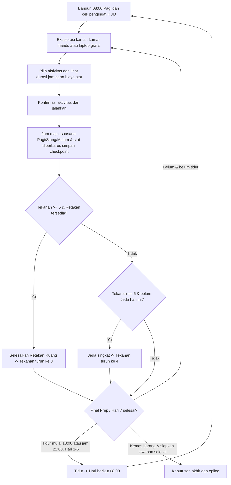
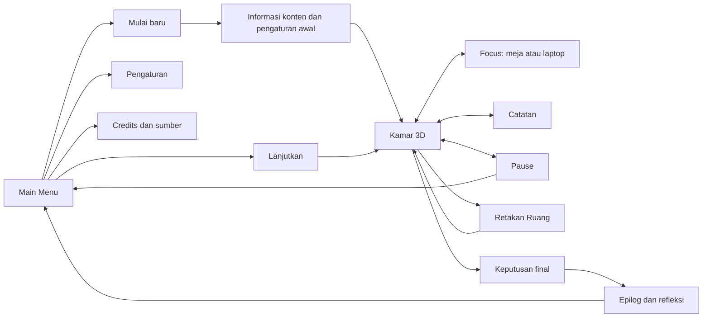

# SELA
## Game Design Document

*Sebentar lagi harus menjawab. Belum tentu harus mengiyakan.*

| Project Identity | Design Target |
| --- | --- |
| Platform | PC Windows, dimainkan secara luring |
| Engine | Unity, lingkungan utama 3D |
| Perspective | First-person, single-player |
| Genre | Psychological narrative, eksplorasi ruang, pengelolaan aktivitas ringan |
| Playtime | Target 45-60 menit untuk satu permainan pertama |
| Structure | Maksimal tujuh hari cerita, waktu jam harian (`08:00–22:00`) dengan suasana Pagi/Siang/Malam, tiga ending |
| Setting | Kamar kos dan lorong pendek di kota fiktif Indonesia |
| SDG Focus | SDG 3: Good Health and Well-Being; SDG 8: Decent Work and Economic Growth |
| Production Target | Tiga anggota, empat hingga enam minggu |

Angka durasi, performa, dan keseimbangan di dokumen ini merupakan sasaran desain yang perlu diuji melalui playtest, bukan hasil pengukuran produk jadi.

## 1. Game Overview

### 1.1 High Concept

Raka, lulusan Informatika yang sudah delapan bulan mencari kerja, memiliki tujuh hari sebelum masa sewa kosnya berakhir. Bekal kebutuhan dasar dan tiket bus untuk pagi hari kedelapan sudah tersedia. Ia ingin pulang membawa kabar baik, tetapi semakin sulit membedakan keinginannya sendiri dari tuntutan yang ia bayangkan datang dari orang lain.

Pemain menjalani hari dari sudut pandang Raka: memperbaiki contoh proyek, menyusun lamaran di laptop, memeriksa syarat kerja, dan sesekali meninggalkan meja untuk berbicara dengan seseorang. Ketika kalimat penolakan mulai memenuhi pikirannya, benda-benda di kamar berubah tempat. Meja terasa semakin jauh. Pintu memiliki nama yang tidak pernah dicat siapa pun. Pemain mengembalikan ruang dengan mencocokkan benda nyata dengan informasi yang sudah ia ketahui.

Pertanyaan utamanya adalah pekerjaan seperti apa yang patut diterima, serta batas apa yang masih ingin dipertahankan Raka. Mendapatkan pekerjaan merupakan salah satu hasil yang baik. Pulang sambil menyusun rencana berikutnya juga merupakan penutup yang sah.

### 1.2 Purpose of the Game

Pencarian kerja sering disederhanakan menjadi persoalan rajin melamar. Dalam cerita ini, Raka juga menghadapi informasi lowongan yang tidak jelas, tuntutan pengalaman untuk posisi pemula, dan rasa bersalah karena masih menerima bantuan keluarga. WHO menjelaskan bahwa ketidakamanan kerja, beban berlebihan, kontrol kerja yang rendah, serta pengangguran dapat berkaitan dengan risiko kesehatan mental [R3]. Game memakai konteks tersebut tanpa membuat klaim tentang prevalensinya pada seluruh lulusan Indonesia.

Tujuan sosial dan pembelajaran SELA adalah agar pemain dapat:

1. Membedakan bukti kemampuan dari klaim yang belum dapat dipertanggungjawabkan.
2. Menemukan tanda risiko dalam tawaran kerja, seperti penahanan dokumen asli, jam kerja tanpa batas yang jelas, dan desakan untuk segera menyetujui syarat.
3. Menjelaskan bahwa pekerjaan layak mencakup kondisi kerja dan hak pekerja, bukan hanya nominal penghasilan.
4. Mengenali kebutuhan untuk berhenti sejenak dan menghubungi orang lain ketika tekanan meningkat.

| SDG Alignment | Penerapan dalam permainan | Bukti yang dapat dibahas setelah bermain |
| --- | --- | --- |
| SDG 3, target 3.4: kesehatan mental dan kesejahteraan [R1] | Aktivitas pemulihan tetap tersedia; tekanan tinggi tidak mengakhiri permainan; dukungan sosial hadir dalam cerita | Pemain dapat menyebutkan keputusan yang membantu Raka mengambil jeda |
| SDG 8, target 8.5 dan 8.8: pekerjaan layak dan perlindungan hak pekerja [R2] | Pemain memeriksa kompensasi, jam kerja, ruang lingkup tugas, serta perlindungan dokumen sebelum memilih kontrak | Pemain dapat membandingkan dua tawaran berdasarkan syaratnya |

Game hanya menggunakan dua SDG tersebut. Keterkaitannya ditanamkan pada keputusan dan konsekuensi, bukan berupa kuis hafalan nomor SDG.

Tekanan merupakan abstraksi untuk kebutuhan permainan. Nilainya bukan diagnosis, ukuran kewarasan, atau prediksi kondisi seseorang. Merapikan kamar, tidur, dan percakapan singkat juga tidak digambarkan sebagai pengganti perawatan profesional.

### 1.3 Intended Use

SELA merupakan game naratif mandiri. Pemain dapat menyelesaikannya tanpa pengajar, akun daring, atau pengetahuan pemrograman. Semua informasi yang diperlukan untuk mengambil keputusan tersedia di dalam game.

Dalam kegiatan pembelajaran, game dapat menjadi pelengkap diskusi tentang transisi kuliah ke dunia kerja. Skenario penggunaan yang disarankan adalah pengantar singkat, satu sesi bermain, lalu diskusi sekitar 10-15 menit. Pengajar dapat membahas alasan pemain menerima atau menolak tawaran, bukti yang mendasari keputusan, serta pilihan yang tersedia selain terus menambah lamaran.

Contoh pertanyaan diskusi:

- Syarat apa yang membuat tawaran terlihat aman atau justru berisiko?
- Apakah Raka masih memiliki pilihan ketika sebuah lamaran ditolak?
- Bagian mana dari tekanan Raka berasal dari keputusan pribadi, dan bagian mana dari kondisi rekrutmen?

Game tidak ditujukan untuk terapi, diagnosis, rehabilitasi, atau pelatihan hukum ketenagakerjaan. Kontrak dan nama perusahaan di dalamnya bersifat fiktif. Pemain yang tidak nyaman dapat menurunkan intensitas atmosfer atau keluar tanpa kehilangan checkpoint terakhir.

### 1.4 Justification for Use

Wouters, van Nimwegen, van Oostendorp, dan van der Spek menemukan keunggulan rata-rata serious games pada pembelajaran dan retensi dalam meta-analisis mereka, tetapi tidak menemukan keunggulan motivasi yang signifikan dibandingkan pengajaran konvensional. Hasil pembelajaran juga lebih baik ketika game dilengkapi metode pengajaran lain [R4]. Temuan tersebut mendukung penggunaan keputusan interaktif dan diskusi pendamping, bukan menjamin efektivitas SELA.

Hipotesis desainnya: pemain lebih mudah membahas batas kerja ketika mereka harus membaca syarat, mempertimbangkan waktu, dan menyampaikan keputusan sebagai tokoh yang memiliki alasan personal. Efektivitas game ini belum dibuktikan. Evaluasi awal memakai pertanyaan sebelum dan sesudah bermain tentang tanda risiko lowongan dan unsur pekerjaan layak. Setelah bermain, peserta juga membaca satu contoh tawaran fiktif di luar cerita, lalu menyebutkan bagian yang perlu ditanyakan serta alasannya. Contoh ini menjadi bahan evaluasi terpisah dan tidak menambah lowongan dalam game. Catatan playtest tidak boleh disebut sebagai bukti klinis.

Identitas SELA terletak pada hubungan antara meja lamaran dan ruang fisik. Bukti yang pemain pelajari di meja juga menjadi pegangan ketika kamar berubah. Tidak ada mekanisme dari judul referensi yang dipindahkan sebagai paket permainan.

### 1.5 Target Audience

Sasaran utama adalah pemain berusia 18-25 tahun, terutama mahasiswa tingkat akhir dan pencari kerja awal karier. Pemain yang menyukai cerita pendek, eksplorasi, dan ketegangan tanpa pertarungan menjadi sasaran sekunder.

Bahasa utama adalah bahasa Indonesia. Istilah CV, portofolio, interview, dan kontrak tetap digunakan sesuai konteks. Materi sensitif mencakup penolakan kerja, tekanan finansial, perbandingan sosial, dan rekrutmen eksploitatif. Tidak ada visual melukai diri, kekerasan grafis, atau adegan bunuh diri.

### 1.6 Genre and Design Pillars

Genre utamanya adalah psychological narrative dengan eksplorasi first-person 3D. Horor muncul dari perubahan ruang, jeda percakapan, dan ketidaksesuaian informasi. Pemain tidak bertarung, bersembunyi dari musuh, atau menguji refleks.

Desain berpegang pada keputusan yang terbaca: konsekuensi aktivitas terlihat sebelum dipilih, syarat tawaran dapat diperiksa, dan ending dapat ditelusuri dari keputusan terakhir. Rutinitas dibuat pendek agar waktu bermain lebih banyak dipakai untuk memperhatikan perubahan dan menimbang pilihan.

## 2. Gameplay

### 2.1 Objectives

Tujuan utama adalah menentukan langkah Raka sebelum masa sewa kosnya berakhir pada pagi hari kedelapan. Pemain dapat menerima salah satu tawaran kerja yang memenuhi kebutuhannya atau pulang dengan rencana lanjutan. Pemain juga dapat menyetujui kontrak yang membatasi kebebasannya setelah melewati peringatan yang jelas. Mulai hari ke-4 (setelah tawaran Akses Prima masuk) atau pada hari ke-7, pemain dapat menjalankan satu sesi persiapan akhir (*Kemas barang & siapkan jawaban*) kapan saja ketika sudah siap mengunci keputusan, tanpa dipaksa menunggu hingga larut malam hari ketujuh.

Tujuan selama permainan adalah menyiapkan bukti kemampuan, menjaga ruang untuk pemulihan agar Tekanan tetap terkendali, mengikuti interview tepat waktu, dan memeriksa informasi sebelum menyetujui tawaran. Tidak semua aktivitas harus dilakukan untuk mencapai penutup yang utuh. Melewati minggu tanpa melamar tetap menghasilkan ending dengan konsekuensi naratif yang sesuai.

### 2.2 Core Loop

Pemain bangun di kamar kos pada pukul `08:00` (`Pagi`), membaca pesan baru atau pengingat satu baris pada HUD, lalu memilih aktivitas di kamar atau laptop. Eksplorasi, membaca, membuka pintu/saklar, dan memeriksa benda **tidak memajukan waktu**. Aktivitas yang membutuhkan waktu selalu memperlihatkan durasi jam serta perubahan Tenaga/Tekanan sebelum dikonfirmasi.

Pengenalan dilakukan bertahap tanpa mengunci kebebasan pemain: membaca E0 secara gratis, membuka lalu membatalkan panel aktivitas, menyelesaikan satu aktivitas pilihan, melihat pergeseran jam dan pencahayaan, menyusun CV, lalu meninjau panel pengiriman. Penjelasan snapshot muncul sebelum pengiriman pertama dan dapat dibaca kembali di Catatan.

Waktu bergerak secara diskret sesuai durasi tiap aktivitas (`1`, `2`, atau `3 jam`), tanpa hitung mundur real-time yang memburu pemain. Suasana ruang (`Pagi`, `Siang`, `Malam`) otomatis mengikuti jam berjalan: `Pagi` (`08:00–11:59`), `Siang` (`12:00–17:59`), dan `Malam` (`18:00–22:00`). Mulai pukul `18:00` (`Malam`), pemain boleh menutup hari kapan saja melalui kasur (*Tidur / Tutup hari*), dan pada pukul `22:00` aktivitas berdurasi ditutup hingga pemain tidur. Jika Tekanan mencapai ambang `5–6` sesudah suatu aktivitas, Retakan Ruang yang tersedia untuk babak tersebut langsung aktif; jika pemain menjaga Tekanan tetap `≤ 4`, Retakan tidak terjadi.

Target pembagian durasi adalah sekitar lima menit pengenalan, 25-35 menit rutinitas serta keputusan, 0-9 menit untuk Retakan Ruang sesuai manajemen Tekanan pemain, dan 5-8 menit penutup. Sebagian pemain dapat selesai lebih cepat karena tidak ada waktu tunggu wajib pada teks maupun kewajiban menunggu malam hari ketujuh.

### 2.3 Game Progression and Play Flow

| Day | Perkembangan utama | Pilihan yang ditekankan |
| --- | --- | --- |
| 1 | Raka membaca pesan ibu, mengenali bekal, dan membuka lowongan Studio Lajur; Retakan 1 terbuka bila Tekanan ≥ 5 | Menyiapkan bukti E1 atau langsung mengirim klaim yang belum siap |
| 2 | Penolakan lama kembali dibahas di inbox; interview pertama bila sudah melamar Hari 1 | Mengelola jadwal pukul `13:00` serta menjaga Tenaga dan Tekanan |
| 3 | Revisi kedua portofolio (E2) tersedia; Koperasi Pijar membuka lowongan; Retakan 2 terbuka bila Tekanan ≥ 5 | Membagi jam harian antara belajar, pemulihan (termasuk Mandi), dan lamaran B |
| 4 | Pesan Akses Prima datang pagi hari; sesi persiapan akhir (*Kemas barang & siapkan jawaban*) mulai tersedia bila pemain siap menutup cerita lebih awal | Memeriksa tawaran yang terdengar paling mudah vs melanjutkan persiapan |
| 5 | Batas lamaran Koperasi Pijar berakhir (`22:00`); Ibu mengirim pesan bahwa tiket tetap boleh dipakai (membuka jangkar Retakan 3 bila Tekanan ≥ 5) | Meninjau pendampingan, lembur, atau kelanjutan kontrak |
| 6 | Interview terakhir jika terjadwal (`13:00`); perbandingan pilihan di Map Tawaran & Catatan | Menghubungkan syarat kerja dengan kebutuhan Raka |
| 7 | Batas akhir masa sewa sebelum keberangkatan pagi Hari 8; Ibu menanyakan jawaban terakhir | Menjalankan sesi persiapan akhir (*Kemas barang & siapkan jawaban*) kapan saja hari ini untuk mengunci keputusan |

Urutan informasi utama tetap. Dialog, isi map lamaran, dan tampilan kamar menyesuaikan riwayat aktivitas. Tidak ada rotasi lowongan acak atau cabang yang memerlukan level baru.

Pesan hari 5-7 memakai tiga konteks: dua tawaran resmi, satu tawaran resmi, atau belum ada tawaran resmi. Semua tampil melalui Pesan dan Catatan yang sudah ada. Ajakan meninjau syarat tidak menahan informasi penting sampai hari tersebut; hasil verifikasi tetap dapat diperoleh lebih awal. Pembacaan dan perbandingan gratis waktu.

### 2.4 Mission, Challenge, and Puzzle Structure

Tantangan pengelolaan waktu menggunakan jendela jam harian `08:00–22:00` (14 jam per hari) selama maksimal 7 hari. Setiap aktivitas memiliki durasi wajar (`1–3 jam`) sehingga pemain merasakan bobot waktu yang alami: pekerjaan portofolio butuh `3 jam`, verifikasi/lamaran/interview butuh `2 jam`, sedangkan pemulihan singkat seperti Mandi, Duduk tanpa layar, atau Rapikan meja hanya `1 jam`. Pemain dapat menyelesaikan seluruh persiapan inti sejak hari 4 dan langsung memilih sesi persiapan akhir (*Kemas barang & siapkan jawaban*) bila sudah mantap, atau memanfaatkan hari 5–7 untuk verifikasi, pemulihan, dan menimbang pilihan. Persiapan tidak menuntut penguasaan bahasa pemrograman secara nyata.

Tantangan lamaran menghubungkan satu klaim CV dengan hasil kerja yang dapat ditunjukkan. Pemain boleh memilih kalimat berlebihan, tetapi game memperlihatkan ketidaksesuaian tersebut dan menyediakan kesempatan untuk meluruskannya saat interview. Tidak ada hukuman blacklist lintas perusahaan.

Tantangan kontrak meminta pemain menelusuri empat aspek: tugas, kompensasi, jam kerja, dan dokumen pribadi. Tawaran resmi juga harus dibaca; label perusahaan bukan jaminan otomatis.

Tiga puzzle Retakan Ruang bersifat **berbasis Tekanan (`Tekanan ≥ 5`)** dan menggunakan benda nyata yang telah diperkenalkan. Pemain membawa satu benda ke titik jangkar yang sesuai memakai tombol `E`. Tidak ada kode acak, musuh, batas waktu, atau kematian. Kegagalan menempatkan benda hanya menghasilkan petunjuk. Menjaga Tekanan tetap `≤ 4` melalui istirahat, mandi, dan dukungan sosial memungkinkan pemain mencegah Retakan terjadi; sebaliknya, memaksakan ritme kerja hingga Tekanan tinggi memunculkan Retakan sebagai momen refleksi interaktif yang menurunkan Tekanan kembali ke 3.

### 2.5 Example Play Session

Pada Hari 3 pukul `08:00` (`Pagi`), Raka memiliki Tenaga 3 dan Tekanan 2. Pemain menyelesaikan bukti kedua E2 (`3 jam`, `08:00 → 11:00`): Tenaga menjadi 2, Tekanan menjadi 3 (suasana mulai menegang). Pemain lalu memeriksa Koperasi Pijar (`2 jam`, `11:00 → 13:00`, suasana berganti ke `Siang`): Tenaga menjadi 1, Tekanan tetap 3. Pemain kemudian mengirim lamaran Koperasi Pijar (`2 jam`, `13:00 → 15:00`): Tenaga menjadi 0, Tekanan menjadi 4, dan interview dicatat untuk Hari 4 pukul `13:00`.

Karena Tekanan sudah 4 dan Tenaga 0, pemain memilih **Mandi** di kamar mandi dalam (`1 jam`, `15:00 → 16:00`): Tenaga pulih menjadi 2 dan Tekanan turun drastis ke 1—menjaga Raka tetap jauh dari ambang Retakan `5`. Pada pukul `18:00` (`Malam`), pemain bisa langsung memilih **Tidur / Tutup hari** di kasur (`Tenaga +2, Tekanan −1`) untuk memulai Hari 4 pukul `08:00` dengan Tenaga 4 dan Tekanan 0, siap menghadapi interview pukul `13:00`. Tidak ada peluang acak yang menentukan diterima atau ditolaknya lamaran.

## 3. Mechanics

### 3.1 Rules and State Variables

| State | Rentang atau bentuk | Nilai awal | Fungsi |
| --- | --- | --- | --- |
| `day` | 1-7 | 1 | Mengatur batas lamaran, pesan harian, dan batas maksimal sewa |
| `currentHour` | Bilangan bulat `8`–`22` (`08:00`–`22:00`) | `8` (`08:00`) | Waktu harian diskret; hanya maju saat aktivitas selesai |
| `timeOfDay` / `session` | `Pagi` (`08–11`), `Siang` (`12–17`), `Malam` (`18–22`) | `Pagi` | Status suasana & pencahayaan lingkungan yang diturunkan otomatis dari `currentHour` |
| `energy` / Tenaga | Bilangan bulat 0-4 | 3 | Biaya aktivitas yang memerlukan konsentrasi |
| `pressure` / Tekanan | Bilangan bulat 0-6 | 1 | Mengatur intensitas atmosfer, pemicu Retakan Ruang (`≥ 5`), dan Jeda cadangan (`6`) |
| `evidence` | Himpunan kartu E0, E1, E2 | E0 | Menyimpan seluruh bukti yang dimiliki; E1/E2 ditambahkan tanpa menghapus E0 |
| `cvDraft` | Dua klaim dan daftar bukti terpasang | Klaim sesuai peran awal; bukti lamaran kosong | Draf yang dapat diedit tanpa mengubah snapshot terkirim |
| `application[A,B]` | Belum dikirim, terjadwal (`13:00`), ditolak, ditawari | Belum dikirim | Status dua lamaran resmi; menarik pilihan tidak menghapus tawaran |
| `verification[A,B,C]` | Belum diperiksa atau diperiksa | Belum diperiksa | Kelengkapan catatan tawaran |
| `offerChoice` | Tidak ada, A, B, C | Tidak ada | Pilihan sementara sebelum keputusan final |
| `decisionNote` | Belum dipilih atau satu catatan sesuai pilihan final | Belum dipilih | Batas kerja A/B atau langkah setelah pulang; dapat diatur sebelum atau saat panel final |
| `riftSolved[1..3]` | Benar atau salah | Semua salah | Progres tiga Retakan Ruang berbasis Tekanan |
| Daily flags | `deskTidiedToday`, `showeredToday`, `jedaTriggeredToday`, `ditaCalledToday`, `riftTriggeredToday` | Salah | Membatasi aksi sekali per hari dan maksimal satu Retakan per hari |

Nilai Tenaga dan Tekanan selalu dibatasi pada rentangnya setelah perubahan. Tidak ada penurunan stat karena pemain berdiam diri, membaca lambat, membuka menu, atau menjelajahi kamar. Keahlian yang sudah dibuktikan tidak hilang akibat beristirahat.

Raka memiliki persediaan kebutuhan dasar untuk tujuh hari dan tiket pulang yang telah dibeli. Keduanya merupakan informasi cerita, bukan item yang bisa dijual atau habis karena aktivitas. Tidak ada simulasi kelaparan, uang harian, toko, atau utang. Batas finansial hadir sebagai berakhirnya masa sewa, sehingga permainan tidak membutuhkan ekonomi tambahan.

### 3.2 Time, Scheduling, and Resolution Order

Setiap aktivitas pada tabel 3.3 memajukan jam harian (`currentHour`) sesuai durasinya (`1`, `2`, atau `3 jam`). Jam tidak berjalan otomatis saat pemain berjalan, membaca, atau membuka menu. Sebelum konfirmasi, panel menyebutkan nama aktivitas, durasi serta jam selesai, perubahan kondisi, dan peringatan jika berpotensi memicu Retakan Ruang atau melewati jadwal interview. Membatalkan panel tidak mengubah apa pun.

Suasana ruang (`Pagi`, `Siang`, `Malam`) selalu mengikuti `currentHour`:
- **Pagi (`08:00–11:59`)**: Cahaya hangat dari jendela.
- **Siang (`12:00–17:59`)**: Cahaya netral merata.
- **Malam (`18:00–22:00`)**: Intensitas redup; pemain mulai bisa memilih **Tidur / Tutup hari** di kasur kapan saja.

Urutan penyelesaian adalah: validasi syarat & kecukupan waktu sebelum `22:00`, jalankan interaksi aktivitas, terapkan biaya stat (delta dijumlahkan sebelum pembatasan rentang) & majukan jam, simpan checkpoint stabil, lalu periksa pemicu **Retakan Ruang** (`Tekanan ≥ 5` & ada Retakan belum selesai yang sudah terbuka dan belum terjadi hari ini); jika tidak memicu Retakan, periksa **Jeda cadangan** (`Tekanan == 6` & belum Jeda hari ini). Menyimpan checkpoint sebelum Retakan memastikan keluar saat Retakan hanya mengulang Retakan, bukan menghapus interview yang baru selesai.

Pada pukul `22:00`, hari mencapai batas larut malam: tombol aktivitas berdurasi biasa dinonaktifkan dengan keterangan `Sudah larut malam (22:00). Gunakan kasur untuk tidur.`, sementara aktivitas gratis (membaca, menyusun CV, meninjau Map Tawaran) serta sesi persiapan akhir (`Kemas barang & siapkan jawaban`) tetap tersedia. Tidur pada Hari 1–6 (tersedia sejak `18:00`) memulai hari berikutnya pada `08:00` (`Pagi`), menambah Tenaga `+2`, mengurangi Tekanan `−1`, dan mereset flag harian. Pada Hari 7 mulai `18:00` (atau kapan saja lewat Tas/Map Tawaran), kasur mengarahkan pemain ke sesi persiapan akhir (*Kemas barang & siapkan jawaban*) lalu panel Keputusan Akhir, bukan hari kedelapan.

Interview selalu dijadwalkan pada hari setelah lamaran dikirim pukul **`13:00` (`Siang`)** dengan durasi `2 jam` (selesai `15:00`). Pada hari interview, selama `currentHour ≤ 13:00`, tombol `Ikuti interview` langsung tersedia—jika diklik sebelum `13:00`, Raka menunggu hingga `13:00` lalu menjalani interview hingga `15:00`. Pemain tetap bebas menjalankan aktivitas pagi lain selama selesai `≤ 13:00`. Jika pemain memilih aktivitas yang melampaui `13:00`, panel menampilkan peringatan bahwa undangan akan terlewat; jika dilanjutkan, interview berstatus ditolak dan menambah Tekanan `+1` (dijumlahkan bersama efek aktivitas pengganti sebelum pemeriksaan Retakan/Jeda). Tidak ada penolakan ganda untuk undangan yang sama.

Panel pengiriman mencantumkan `Interview besok pukul 13:00: perlu Tenaga 1`. Pada awal pagi hari interview (`08:00`), pengingat HUD dan kartu jadwal mengulang syarat itu bersama Tenaga saat ini agar pemain sempat memulihkan kondisi (misalnya `Mandi` 1 jam atau `Beristirahat` 2 jam) sebelum `13:00`. Tidak ada pemindahan jadwal otomatis.

### 3.3 Actions

Setiap objek utama di `progress.unity` memiliki satu fungsi jelas agar antarmuka tidak tumpang tindih:

| Action | Lokasi (`progress.unity`) | Durasi | Tenaga | Tekanan | Syarat dan hasil |
| --- | --- | --- | --- | --- | --- |
| Rapikan contoh antarmuka | Papan Bukti (`SM_Papan_Bukti`) | 3 jam | −1 | +1 | Sekali; menghasilkan E1 |
| Lengkapi catatan pengujian | Papan Bukti (`SM_Papan_Bukti`) | 3 jam | −1 | +1 | Mulai Hari 3, sudah memiliki E1; sekali; menghasilkan E2 |
| Periksa perusahaan | Laptop (`SM_Laptop`) | 2 jam | −1 | 0 | Sekali per perusahaan (A/B/C) setelah dibuka; membuka ringkasan verifikasi |
| Kirim lamaran | Laptop (`SM_Laptop`) | 2 jam | −1 | +1 | Sekali untuk A (Hari 1–3) & B (Hari 3–5); menyimpan snapshot CV & jadwal interview besok `13:00` |
| Ikuti interview | Laptop (`SM_Laptop`) | 2 jam | −1 | +2 | Hari interview saat `jam ≤ 13:00` (berjalan `13:00–15:00`); dua pertanyaan & hasil langsung (ditolak = +1 Tekanan) |
| Beristirahat | Kasur (`SM_Kasur`) | 2 jam | +3 | −2 | Tersedia `08:00–17:59` (Pagi–Siang), dapat diulang; pemulihan Tenaga terbesar |
| Mandi | Kamar Mandi (`SM_Shower` / `SM_Bak_Mandi`) | 1 jam | +2 | −3 | Maksimal sekali sehari; pemulihan Tekanan terbesar |
| Hubungi / Temui Dita | Kamar Dita 06 (`SM_Kamar_Kiri` di seberang lorong) / Ponsel (`SM_Ponsel`) | 2 jam | +2 | −2 | Selalu tersedia; percakapan tatap muka atau pesan harian berbeda, pengulangan memakai teks singkat |
| Duduk tanpa layar | Kursi jendela (`SM_Kursi_Jendela`) | 1 jam | +2 | −2 | Selalu tersedia; pengamatan singkat yang dapat dilewati |
| Rapikan meja | Meja fisik (`SM_Meja`) | 1 jam | +1 | −1 | Maksimal sekali sehari; mengganti susunan benda, tidak memengaruhi penilaian interview |
| Kemas barang & siapkan jawaban | Tas / Map Tawaran (`SM_Tas` / `SM_Map_Tawaran`) | 2 jam | 0 | 0 | Mulai Hari 4 (atau kapan saja di Hari 7, tidak diblokir batas `22:00`); membuka panel Keputusan Akhir |

Aktivitas dengan biaya Tenaga 1 memerlukan Tenaga minimal 1. Pemain selalu dapat berjalan dan memilih aktivitas pemulihan pada Tenaga 0. Tidak ada pingsan atau penguncian semua pilihan. Mulai pukul `18:00` (`Malam`), `SM_Kasur` menawarkan **Tidur / Tutup hari** (bukan `Beristirahat`) agar penutupan malam berlangsung mulus dalam satu langkah tanpa tidur siang tepat sebelum tidur malam.

Mengulang aktivitas pemulihan sah dan secara aktif membantu mencegah Retakan Ruang; konsekuensinya berupa berkurangnya jam harian untuk menyiapkan lamaran, bukan pengurangan kecerdasan atau penilaian moral.

Panel pemulihan menyebut pengalaman yang menyertai angka: Beristirahat memulihkan Tenaga paling banyak; Mandi memulihkan Tekanan paling besar sekali sehari; Hubungi Dita menawarkan percakapan pertama hari itu; Duduk tanpa layar memberi pengamatan singkat; Rapikan meja memperlihatkan perubahan benda (meja kembali berantakan saat hari berganti atau setelah pekerjaan bukti E1/E2). Percakapan Dita memakai satu teks dasar per hari dengan sisipan pendek sesuai hasil lamaran. Duduk memakai tiga pengamatan untuk awal, tengah, dan akhir minggu; merapikan meja memakai dua catatan benda; mandi memakai catatan kesegaran singkat. Pengulangan memakai respons singkat tanpa membuka syarat kerja atau bantuan eksklusif.

Animasi hasil aktivitas berdurasi sekitar 2-4 detik dan bisa dilewati setelah hasil logis diterapkan. Pilihan singkat dalam pekerjaan E1/E2 dijelaskan pada bagian 3.5 dan tidak memakai batas waktu. Melewati animasi tidak mengubah hasil.

### 3.4 Pressure, Retakan Trigger, and Jeda Fallback

Tekanan (`0–6`) menjadi mekanik inti yang menggerakkan atmosfer kamar sekaligus memicu **Retakan Ruang**:

- **Tekanan 0–2 (Stabil)**: Benda memiliki posisi normal dan suara kamar terdengar utuh.
- **Tekanan 3–4 (Tegang)**: Bayangan kusen bergeser sedikit, suara lorong meredup, dan notifikasi memiliki ekor gema pendek sebagai peringatan diegetik bahwa Tekanan mendekati ambang Retakan. Teks, jalur jalan, dan objek penting tetap jelas.
- **Tekanan 5–6 (Ambang Retakan)**: Sesudah aktivitas selesai dan checkpoint tersimpan, jika ada **Retakan Ruang** yang sudah terbuka untuk babak berjalan dan belum terjadi hari ini, permainan langsung memicu Retakan tersebut. Menyelesaikan Retakan menurunkan **Tekanan ke 3** dan menetapkan **Tenaga minimal 1** tanpa menghabiskan jam tambahan.

Jika Tekanan mencapai **6** pada hari yang sama ketika tidak ada Retakan yang memenuhi syarat (sudah pernah mengalami Retakan hari itu, atau seluruh Retakan yang terbuka sudah diselesaikan), permainan membuka **Jeda cadangan**: Raka dapat duduk sebentar atau mengirim pesan singkat kepada Dita. Keduanya menurunkan Tekanan menjadi `4` dan menetapkan Tenaga menjadi minimal `1`, tanpa menggunakan jam dan dapat dilewati lewat tombol `Lanjut`.

Jeda cadangan hanya terjadi sekali per hari. Jika Tekanan kembali mencapai 6 pada hari yang sama setelah Jeda terjadi, nilainya tetap 6 sampai pemain pulih atau tidur; tampilan dan audio mempertahankan perlakuan Tekanan 3–4 tanpa menambah efek baru. Tekanan mengatur suasana, kemunculan Retakan, serta Jeda, **tanpa** menentukan penerimaan kerja, ending, atau ketepatan jawaban. Pratinjau aktivitas menyebut bila aktivitas akan memicu Retakan atau Jeda (dan pada interview menyebut bahwa penolakan `+1 Tekanan` dapat memicu Retakan/Jeda).

### 3.5 Evidence and CV Assembly

Meja Bukti adalah tampilan dekat papan fisik di atas meja (`SM_Papan_Bukti`). Pemain memilih kartu melalui klik, kemudian memilih penjepit tujuan. Tidak perlu drag-and-drop presisi. Kartu yang dipilih dapat dikembalikan tanpa biaya waktu.

| Evidence | Isi yang terlihat | Sumber | Penggunaan |
| --- | --- | --- | --- |
| E0: Proyek kuliah | Foto hasil proyek dan keterangan bahwa Raka bekerja sebagai anggota tim | Sudah tersedia sejak awal | Pengenalan tokoh dan jangkar Retakan pertama; belum memenuhi kebutuhan lowongan |
| E1: Antarmuka formulir | Gambar sebelum/sesudah, label input, pesan kesalahan yang diperbaiki | Aktivitas Rapikan contoh antarmuka | Syarat bukti untuk A dan B |
| E2: Catatan pengujian | Tiga kasus uji: kolom kosong, format salah, dan data valid; hasil serta batas pengujian | Aktivitas Lengkapi catatan pengujian | Syarat tambahan untuk B |

Setiap pekerjaan bukti memiliki satu pilihan singkat melalui kartu yang sama dengan Meja Bukti. Pada E1, pemain membandingkan dua pasangan label dan pesan kesalahan: Input / Error dengan Alamat email / Isi alamat email dengan format yang sesuai, lalu memilih pasangan yang lebih membantu pengguna. Pada E2, ketiga kasus uji sudah terlihat; pemain memilih kesimpulan antara Tiga kasus yang dicatat berjalan sesuai hasil ini dan Seluruh kemungkinan kesalahan sudah teruji. Jawaban yang kurang tepat diberi alasan dan boleh dipilih ulang tanpa biaya, perubahan stat, atau pengurangan kualitas bukti. Setelah pilihan selesai, kartu E1/E2 diberikan dan satu biaya aktivitas diterapkan. Tidak ada editor kode atau tantangan mengetik.

Hasil E1 memperlihatkan perubahan yang dikerjakan Raka. Hasil E2 menyebut tiga kasus beserta batas pemeriksaannya. Isi tersebut tetap dapat dibaca di Catatan dan menjadi rujukan jawaban interview. Pilihan dalam persiapan tidak menghasilkan skor atau bukti tambahan.

CV memiliki dua baris klaim. Baris pertama memilih antara membantu pengembangan antarmuka proyek kuliah dan memimpin sistem produksi perusahaan. Baris kedua memilih antara menguji formulir secara manual dan menjamin sistem bebas seluruh kesalahan. Pilihan berlebihan selalu diberi catatan bahwa bukti saat ini tidak mendukungnya. Pemain tetap boleh menggunakannya.

Pemain memasang E1/E2 yang sudah dimiliki dan memilih kalimat klaim. Menyusun, mengganti, atau membaca CV tidak menghabiskan waktu. Panel sebelum pengiriman menampilkan perusahaan, kedua klaim, kartu terpasang, bukti wajib yang belum ada, jadwal interview (`besok pukul 13:00`), serta biaya waktu dan stat. Lamaran menyimpan klaim dan bukti pada saat dikirim; perubahan sesudahnya tidak mengubah lamaran yang telah masuk. Riwayat terkirim bersifat baca-saja dan terpisah dari Draf saat ini. Peringatan sebelum konfirmasi menyebut bahwa bukti yang dibuat kemudian tidak ditambahkan ke lamaran lama.

Saat interview, pemain boleh mengoreksi seluruh klaim berlebihan melalui satu pilihan pembuka. Koreksi dicatat sebagai penjelasan interview untuk lamaran tersebut; teks asli dalam snapshot tetap tersimpan. Koreksi memenuhi syarat kejujuran tanpa menambahkan bukti yang tidak ikut dikirim. Tidak ada blacklist global, jawaban yang hilang karena stat, atau hukuman terhadap perusahaan lain.

### 3.6 Laptop and Offer Verification

Laptop berisi tiga tab: Lamaran, Pesan Kerja, dan Catatan. Lamaran memuat CV, lowongan, serta ringkasan tawaran. Pesan Kerja memuat undangan interview, hasil rekrutmen, dan pesan Akses Prima (sedangkan pesan pribadi Ibu dan Dita dapat dibaca lewat Ponsel maupun sinkronisasi ringkas di Catatan). Catatan menyimpan bukti serta fakta untuk puzzle. Tidak ada browser bebas atau aplikasi tambahan.

Membaca iklan dan kontrak tidak menghabiskan waktu. Aktivitas Periksa perusahaan tersedia setelah lowongannya dibuka atau pesan tawaran langsung diterima. Aktivitas berdurasi `2 jam` ini menampilkan rangkuman profil, kontak pembanding, dan jawaban klarifikasi atas pertanyaan yang tercantum di panel. Seluruhnya berupa konten lokal yang telah ditulis, bukan akses internet sebenarnya. Hasil pemeriksaan dapat dibaca ulang gratis.

Pemain menandai empat aspek sebagai Jelas, Perlu ditanyakan, atau Berisiko: tugas; kompensasi; jam kerja dan istirahat; perlindungan dokumen pribadi. Penandaan dapat diubah tanpa biaya. Setelah verifikasi, catatan pembanding menunjukkan bagian yang mendukung atau bertentangan dengan penandaan pemain. Game tidak menyembunyikan informasi keselamatan sampai setelah keputusan final.

| Offer | Jendela dan syarat | Isi tawaran fiktif | Hasil verifikasi |
| --- | --- | --- | --- |
| A: Studio Lajur, Junior UI Implementer | Lamaran Hari 1 `08:00` sampai Hari 3 `22:00`; E1 harus ikut dikirim untuk memenuhi syarat tawaran | Rp4.200.000 per bulan; 40 jam kerja per minggu; dua hari istirahat; uraian tugas antarmuka; dokumen asli tetap dipegang pekerja; jaminan sosial disebutkan tertulis | Profil dan kontak sesuai; pendamping ditetapkan; lembur memerlukan persetujuan dan pencatatan kompensasi |
| B: Koperasi Pijar, Web Support | Lamaran Hari 3 `08:00` sampai Hari 5 `22:00`; E1 dan E2 harus ikut dikirim untuk memenuhi syarat tawaran | Kontrak tiga bulan; Rp3.800.000 per bulan; 35 jam kerja per minggu; dua hari istirahat; tugas pemeliharaan formulir; pendamping; jaminan sosial disebutkan tertulis | Kontak dapat dikonfirmasi; tugas awal dibatasi pada formulir; evaluasi menjelang akhir kontrak tidak menjamin pembaruan; dokumen asli tidak diminta |
| C: Akses Prima, Operator Digital | Pesan hadir Hari 4 `08:00`; tawaran berlaku sampai keputusan akhir (maksimal Hari 7); tanpa lamaran dan interview | Mengiklankan penghasilan sampai Rp12.000.000; jadwal mengikuti kebutuhan; kontrak meminta penyerahan dokumen asli dan membatasi pengunduran diri | Alamat dan kontak tidak konsisten; rincian tugas ditolak; syarat penahanan dokumen tetap dipertahankan |

Nominal tersebut hanya parameter cerita. Kota tidak mewakili wilayah hukum tertentu. Game tidak menyebut nominal tertentu sebagai upah minimum yang sah dan tidak memeringkat A di atas B berdasarkan gaji atau status kontrak.

Setiap hasil pemeriksaan menampilkan Pernyataan awal dan Jawaban klarifikasi pada empat aspek yang sama. Pertanyaan utama A adalah siapa yang mendampingi pekerjaan baru dan bagaimana lembur disetujui. Pertanyaan B adalah tugas awal serta kepastian setelah kontrak tiga bulan; jawaban mengakui bahwa kelanjutannya belum pasti. Pertanyaan C adalah pekerjaan harian dan alasan meminta dokumen asli; admin tetap menolak merinci tugas serta mempertahankan syarat dokumen. Penandaan pemain disandingkan dengan temuan tanpa skor benar/salah. Informasi yang belum terjawab tetap berlabel Perlu ditanyakan.

Akses Prima menawarkan penghasilan tinggi, proses cepat, dan janji penempatan sehingga menarik bagi Raka yang ingin segera membawa kabar baik. Drafnya sudah memperlihatkan syarat berisiko sebelum diverifikasi. Pemeriksaan memperlihatkan ketidakjelasan informasi dan kondisi eksploitatif; game tidak menyimpulkan adanya tindak pidana hanya dari satu tanda. Tidak ada negara atau kebangsaan yang dipakai sebagai penanda penipuan.

Lamaran resmi dengan bukti yang belum cukup tetap dapat dikirim dan mendapat undangan karena kedua perusahaan menyediakan kesempatan penjelasan portofolio dalam cerita. Panel memperingatkan bahwa tawaran tidak dapat diberikan jika bukti wajib tidak ikut dikirim, dan setiap perusahaan hanya menerima satu lamaran. Undangan tidak sama dengan kelulusan. Verifikasi menambah informasi pembanding tanpa menjadi syarat tersembunyi untuk menerima tawaran.

Setiap perusahaan resmi hanya menerima satu lamaran dalam rentang cerita. Jika jadwal interview besok pukul `13:00` sudah terisi, tombol kirim untuk perusahaan lain tidak aktif dan menjelaskan benturan jadwal. Pemain dapat menunggu hari berikutnya selama jendela lamaran masih terbuka. Tidak ada undangan yang diam-diam menimpa undangan lain.

### 3.7 Interview and Results

Interview menggunakan **NPC 3D beranimasi halus** (Nara untuk Studio Lajur, Bagas untuk Koperasi Pijar) yang ditampilkan pada layar panggilan video laptop melalui *studio booth* tersembunyi di luar ruang kos dan `RenderTexture` `512 × 512`. Kamera panggilan hanya aktif saat interview berlangsung sehingga tidak membebani performa Free Roam. NPC menampilkan gerakan halus (*sit idle*, mengangguk, menyimak, berpikir) bersama dialog teks dan dua pertanyaan; suara ketikan serta nada sambungan menggantikan kebutuhan voice acting penuh. Potret 2D tetap tersedia sebagai cadangan (*fallback*) apabila diperlukan. Tidak ada webcam pemain sungguhan atau penilaian penampilan kamar. Sebaliknya, Admin Akses Prima tetap tampil sebagai avatar geometris tanpa wajah dan tanpa panggilan video untuk mempertegas tanda risiko rekrutmen.

Sebelum pertanyaan pertama, pemain dapat meluruskan klaim CV jika diperlukan. Semua pilihan dialog tetap tampil. Catatan bukti yang dikirim dapat dibuka selama interview tanpa biaya atau batas waktu.

| Interview | Pertanyaan dan respons | Nilai internal |
| --- | --- | --- |
| A, pertanyaan 1: Apa yang diperbaiki dan bagaimana kamu memeriksanya? | Menjelaskan perubahan label dan pesan kesalahan dengan E1 / menjelaskan bahwa label perlu spesifik tanpa contoh hasil / menganggap satu pengiriman berhasil sudah membuktikan semua pesan kesalahan tepat | 2 jika E1 dikirim, jika tidak 0 / 1 / 0 |
| A, pertanyaan 2: Bagaimana kamu menangani bagian yang belum dikuasai? | Menjelaskan bagian kerja sendiri lalu meminta pendampingan untuk bagian baru / meminta contoh tugas sebelum memperkirakan kebutuhan belajar / menyetujui seluruh tugas dahulu dan membahas kebutuhan bantuan setelah tenggat | 2 / 1 / 0 |
| B, pertanyaan 1: Apa yang dapat disimpulkan dari catatan pengujianmu? | Menjelaskan tiga kasus E2 dan batas cakupannya / menjelaskan perlunya mengulang pengujian setelah perbaikan tanpa merujuk kasus tercatat / menganggap percobaan data valid cukup untuk menyatakan formulir siap pada semua kondisi | 2 jika E2 dikirim, jika tidak 0 / 1 / 0 |
| B, pertanyaan 2: Bagaimana kamu memulai pekerjaan pemeliharaan? | Meminta prioritas dan ruang lingkup perbaikan lalu menyebut pemeriksaan dampaknya / meminta satu contoh laporan yang paling mendesak / langsung mengubah setiap laporan sesuai urutan masuk tanpa memastikan prioritas dan dampak | 2 / 1 / 0 |

Perusahaan memberi tawaran jika bukti wajib ada pada snapshot pengiriman, tidak ada klaim berlebihan yang belum dikoreksi, setiap jawaban bernilai minimal 1, dan total dua jawaban minimal 3 dari 4. Semua syarat bersifat deterministik. Tekanan, frekuensi merapikan kamar, mandi, dan aktivitas sosial tidak masuk perhitungan.

Jika beberapa syarat gagal, alasan utama ditampilkan dengan urutan bukti wajib belum lengkap, klaim belum diluruskan, lalu penjelasan jawaban belum cukup. Catatan hasil menyimpan alasan lain yang juga berlaku tanpa menampilkan nilai angka. Pesan menyebut kebutuhan posisi yang belum ditunjukkan dan langkah yang dapat dicoba pada kesempatan berikutnya. Penolakan menambah Tekanan `+1` setelah biaya interview dan sebelum pemeriksaan Retakan/Jeda. Hasil disimpan satu kali sehingga membuka pesan berulang tidak menambah tekanan.

Aturan deterministik hanya berlaku pada dua proses rekrutmen fiktif ini. Pesan Dita mengingatkan bahwa kecocokan posisi, kebutuhan perusahaan, dan jumlah kesempatan juga memengaruhi pencarian kerja. Penolakan lama tidak diberi penjelasan seolah semua terjadi karena kesalahan Raka.

Tawaran A/B yang berhasil diperoleh tetap berlaku sampai keputusan akhir dikunci (mulai Hari 4 hingga batas maksimal Hari 7). Pemain dapat memilih, mengganti pilihan, atau menarik pilihannya sebelum finalisasi. Menutup panel tanpa memilih bukan penolakan. Penarikan tawaran yang telah dipilih menggunakan konfirmasi, lalu mengembalikan `offerChoice` ke Tidak ada.

### 3.8 Retakan Ruang

Retakan Ruang dipicu **murni oleh Tekanan (`Tekanan ≥ 5`)** sesudah suatu aktivitas selesai, dengan batas maksimal satu Retakan per hari. Urutan pembukaan babak menjaga agar ketiga Retakan mengikuti perkembangan cerita:
- **Retakan 1 (*Meja yang Menjauh*)**: Terbuka mulai **Hari 1** (jangkar: kartu `E0`).
- **Retakan 2 (*Pintu Bernama*)**: Terbuka mulai **Hari 3** (jangkar: `Kunci 07` pada lorong tiga pintu `SM_Lorong_3Kamar`).
- **Retakan 3 (*Kursi Kosong*)**: Terbuka mulai **Hari 5** (jangkar: `Kartu pesan ibu` yang masuk pagi Hari 5).

Jika pemain berhasil menjaga Tekanan tetap `≤ 4` melalui pemulihan (`Beristirahat`, `Mandi`, `Hubungi Dita`, `Duduk tanpa layar`, `Rapikan meja`), Retakan Ruang tidak terjadi—memberikan imbalan mekanis nyata atas perawatan diri (SDG 3). Retakan tidak memajukan jam dan tidak mengubah hasil rekrutmen; menyelesaikannya memulihkan **Tekanan ke 3** dan menetapkan **Tenaga minimal 1**. Cerita menyajikannya sebagai pengalaman subjektif Raka, tanpa diagnosis atau penjelasan supernatural yang pasti.

| Rift | Perubahan dan tujuan | Solusi | Umpan balik |
| --- | --- | --- | --- |
| 1: Meja yang Menjauh (Hari 1+) | Versi kamar memanjang; lembar penolakan tergantung di antara pemain dan meja | Ambil kartu E0 dari rak awal (`E`) dan pasang pada penjepit berbentuk sudut foto di ujung meja (`E`) | Panjang kamar kembali normal; tulisan Aku belum pernah menyelesaikan apa pun diganti keterangan proyek faktual; Tekanan → 3 |
| 2: Pintu Bernama (Hari 3+) | Lorong `SM_Lorong_3Kamar` menampilkan tiga pintu: DITERIMA, TERLAMBAT, dan 07 | Ambil gantungan kunci 07 dari bangku lorong (`E`) lalu gunakan pada pintu 07 (`E`), sesuai nomor kamar | Dua pintu palsu menjadi bidang dinding; pintu 07 membuka kamar; Tekanan → 3 |
| 3: Kursi Kosong (Hari 5+) | Di sekeliling area kerja terdapat kursi tambahan dengan label tuntutan yang tidak pernah diucapkan | Ambil kartu pesan ibu (*Tiketnya tetap boleh dipakai*) dari meja/rak (`E`) dan letakkan pada dudukan di `SM_Kursi_Jendela` (`E`) | Kursi tambahan hilang; pemain mendengar sisa suara kamar tanpa penilaian menang/kalah; Tekanan → 3 |

E0, nomor 07, dan pesan ibu selalu tersedia untuk puzzle masing-masing saat Retakannya terbuka, terlepas dari pilihan lamaran atau apakah pemain sudah membaca pesan secara sukarela. Saat memasuki Retakan, benda tersebut muncul sebagai salinan khusus puzzle; inventaris cerita tidak terhapus.

E0 diperkenalkan pada awal permainan dengan keterangan bagian antarmuka yang dikerjakan Raka bersama tim. Nomor 07 terlihat pada pintu dan kunci sejak Hari 1. Pesan ibu tentang tiket (*Tiketnya tetap boleh dipakai*) masuk pada pagi Hari 5 sehingga siap untuk Retakan ketiga; percakapan Hari 7 membahas tindak lanjutnya. Petunjuk menghubungkan fakta dengan masalah ruang: hasil kerja melawan pernyataan belum pernah selesai, nomor kamar membedakan alamat dari label hasil, dan pesan ibu membedakan ucapan nyata dari dugaan Raka.

Setiap Retakan memakai paling banyak dua kalimat pembuka alternatif berdasarkan riwayat yang sudah ada. Pada Retakan pertama, kalimat menyesuaikan apakah E1 sudah selesai. Pada Retakan kedua, tawaran resmi yang sudah diperoleh memunculkan kekhawatiran salah memilih; jika belum ada, kekhawatirannya tertinggal. Pada Retakan ketiga, pilihan kerja sementara memunculkan kebutuhan menjelaskan batas, sedangkan belum memilih memunculkan kebutuhan menjelaskan rencana pulang. Variasi teks tidak mengubah layout, solusi, atau akses bantuan. Ruang kembali normal setelah solusi, sementara ketidakpastian kerja tetap ada.

Pemain hanya membawa satu benda puzzle pada satu waktu. Menekan `E` pada tujuan yang salah mempertahankan benda dan menampilkan penjelasan singkat. Menekan `E` pada dudukan asal mengembalikannya. Pilihan `Tampilkan petunjuk` tersedia sejak awal; setelah tiga percobaan salah, label tujuan muncul otomatis. Pemain juga dapat memilih `Selesaikan adegan` dari menu jeda untuk melihat pemulihan ruang dengan hasil cerita dan penurunan Tekanan yang sama. Tidak ada penalti atau ending yang terkunci.

Perubahan skala dan posisi terjadi saat layar memudar singkat, bukan dengan meregangkan kamera ketika pemain berjalan. Area puzzle menggunakan collider tetap dan jalur tunggal yang terbaca. Tidak ada labirin prosedural atau sistem portal.

### 3.9 Controls and Camera

| Input | Free Roam | Focus / Laptop / Puzzle |
| --- | --- | --- |
| W, A, S, D | Bergerak | Tidak menggerakkan karakter saat panel fokus terbuka |
| Mouse | Menoleh | Menggerakkan kursor |
| E | Berinteraksi dengan objek yang disorot | Mengambil atau memasang benda puzzle jika panel tertutup |
| Klik kiri | Tidak menjalankan aktivitas tanpa prompt | Memilih tombol, kartu, dan respons |
| Scroll | Tidak ada fungsi wajib | Menggulir teks |
| Tab | Membuka Catatan | Menutup Catatan dan kembali ke keadaan sebelumnya |
| Esc | Membuka Pause | Menutup panel teratas dahulu; dari puzzle membuka Pause |
| Tombol panah | Tidak ada fungsi wajib | Memindahkan fokus antarkontrol dan pilihan dialog |
| Enter / Spasi | Tidak menjalankan aktivitas dunia | Mengaktifkan kontrol yang mendapat fokus; konfirmasi aktivitas berdurasi tetap melalui panel |
| Page Up / Page Down | Tidak ada fungsi wajib | Menggulir panel baca yang sedang mendapat fokus |

Tidak ada sprint, lompat, jongkok, atau combat. Karakter pemain menggunakan prefab tubuh first-person beranimasi (`Ren_Animated` dengan `PergerakanPemain.controller`: idle, berjalan, duduk, berbaring, mengambil benda) dengan kecepatan jalan target `2,2 meter per detik` dan kamera sejajar mata (`eye-aligned`, clearance depan agar tidak memotong mesh kepala saat menunduk). FOV awal 70 derajat dan dapat diatur 60-90 derajat. Sensitivitas serta invert Y tersedia. Head bob dan camera shake tidak digunakan.

Seluruh interaksi dunia 3D—termasuk mengambil/memasang benda puzzle dan berdiri dari kursi—memakai tombol `E` (atau `Esc` untuk keluar fokus/berdiri), sedangkan klik kiri hanya untuk kontrol UI 2D. Tidak ada tombol tersembunyi tambahan seperti `Q`.

Raycast interaksi memiliki jarak maksimal 2 meter dan mengikuti collider terdekat yang menghalangi pandangan. Objek di balik dinding tidak bisa dipilih. Prompt hanya muncul pada target sah dan menjelaskan aksi beserta durasinya bila memakai waktu, misalnya `E · Baca catatan` atau `E · Mandi · 1 jam`. Tombol aktivitas berdurasi berada di panel konfirmasi agar interaksi awal tidak memajukan waktu tanpa sengaja.

Focus memakai posisi kamera tetap menghadap meja atau laptop. Transisi singkat dapat diganti perpindahan langsung melalui pengaturan Reduce Motion. Saat keluar, kamera kembali ke posisi aman sebelumnya. Cursor terkunci hanya dalam Free Roam; Pause dan seluruh panel fokus melepasnya.

Fokus keyboard terlihat melalui garis tebal dan label, mengikuti urutan baca, serta kembali ke tombol pemanggil setelah dialog ditutup. Panel modal memblokir input dunia dan panel di belakangnya. Tab tetap menjadi tombol Catatan, sehingga navigasi kontrol memakai tombol panah; saat konfirmasi modal terbuka, Tab tidak membuka overlay tambahan. Memasang kartu di panel dapat dilakukan dengan memilih kartu dan tujuan melalui tombol panah serta Enter.

### 3.10 Sound Consideration

Kamar memiliki empat lapisan utama: kipas, aktivitas jauh di lorong, lalu lintas redup, dan suara benda dekat pemain. Titik sumber yang tetap membantu pemain mengenali kapan suasana berubah. Retakan pertama menghilangkan suara lorong, Retakan kedua memindahkan bunyi kunci ke arah pintu 07, dan Retakan ketiga menahan suara kipas sampai kartu dipasang.

Suara tidak menjadi satu-satunya petunjuk. Bunyi kunci memiliki teks arah opsional dan nomor pintu tetap terlihat. Notifikasi menggunakan bunyi pendek dengan volume seragam, bukan lonjakan keras. Tidak ada scream, suara ancaman dari belakang secara acak, atau jumpscare audio.

Master, Ambience, dan Effects memiliki slider terpisah. Semua percakapan tampil sebagai teks. Isyarat penting memiliki caption, misalnya Kunci bergeser di dekat pintu 07. Voice acting penuh tidak masuk cakupan. Musik hanya berupa satu tema singkat di menu dan satu variasi penutup; lisensi seluruh audio harus dicatat pada Credits.

### 3.11 Player Progression and Scoring System

Progres pemain berupa bertambahnya bukti, pemahaman tentang tawaran, dan keputusan yang sudah diambil. Tidak ada level karakter, pohon kemampuan, pengalaman, ranking, achievement, atau leaderboard.

Nilai interview 0-4 hanya membantu resolusi internal. Hasil tidak ditampilkan sebagai nilai kualitas manusia. Setelah interview, pemain menerima penjelasan berbasis bukti. Setelah ending, ringkasan menampilkan bukti yang dipakai, syarat yang telah diperiksa, dan keputusan kontrak.

Ringkasan tidak memberi medali untuk selalu produktif atau menjadikan pulang sebagai hasil bernilai rendah. Menyelesaikan verifikasi memperkaya alasan yang bisa dibaca, tetapi bukan syarat tersembunyi untuk ending kerja.

### 3.12 Win-Lose Conditions and Ending Priority

Keputusan dikunci setelah pemain menjalankan satu sesi persiapan akhir (**Kemas barang & siapkan jawaban**, tersedia mulai **Hari 4** bagi pemain yang sudah siap atau kapan saja pada **Hari 7**) dan menekan `Selesaikan keputusan` pada panel final. Panel menampilkan pilihan sementara (`offerChoice`) serta catatan keputusan (`decisionNote`) dan meminta satu konfirmasi. Pemain dapat kembali meninjau tawaran tanpa menghabiskan waktu tambahan.

Pada panel keputusan (atau lebih awal melalui Map Tawaran), pilihan A/B meminta satu catatan batas yang ingin dikonfirmasi: pendampingan serta ruang lingkup tugas, atau persetujuan serta pencatatan lembur. Keduanya sah dan dicatat sebagai `decisionNote` untuk pesan konfirmasi kerja. Catatan tidak mengubah kontrak, peluang diterima, atau jumlah ending. Pilihan Pulang meminta satu langkah berikutnya: menata bukti proyek atau menyusun jadwal lamaran yang terbatas. Jika pilihan tawaran diganti, catatan yang tidak sesuai direset dan dipilih kembali sebelum finalisasi. Pada C, catatan mengikuti pengakuan atas syarat berisiko pada konfirmasi tambahan.

| Ending | Kondisi final | Konsekuensi cerita |
| --- | --- | --- |
| Mulai dengan Batas | `offerChoice` A atau B dan tawaran tersebut telah diperoleh | Raka mengonfirmasi jadwal mulai serta batas tugas. Variasi A/B mengubah surat dan beberapa kalimat epilog, bukan membuat ending tambahan |
| Pulang, Bukan Selesai | `offerChoice` Tidak ada | Raka menggunakan tiket, membawa portofolio yang sudah disiapkan, dan membuat rencana lanjutan bersama keluarga |
| Kontrak yang Mengunci | `offerChoice` C | Raka menyetujui syarat yang menyerahkan kendali dokumennya. Epilog menunjukkan pembatasan komunikasi dan kesulitan menarik diri, tanpa kekerasan grafis atau menyalahkan korban |

Memilih C menampilkan peringatan khusus tentang dokumen dan pembatasan pengunduran diri, kemudian meminta konfirmasi tambahan. Pilihan itu masih bisa ditarik sampai panel final dikunci. Game tidak menjalankan transfer uang atau pengiriman dokumen sungguhan.

Satu variabel `offerChoice` mencegah dua kontrak diterima bersamaan. Jika tidak ada pilihan sah, hasil selalu Pulang, Bukan Selesai. Tidak ada ending yang dipicu Tekanan, kekurangan Tenaga, puzzle yang dilewati, atau jumlah penolakan. Ending Kontrak yang Mengunci adalah hasil berisiko, bukan rahasia yang diberi hadiah.

Masa sewa selesai pada pagi hari 8, bersamaan dengan jadwal bus pulang. A dan B memerlukan kehadiran di kota kos mulai hari 9. Sejak hari 1, Dita (tetangga Kamar 06) menawarkan bantuan tempat tinggal transisi selama satu bulan jika Raka memilih bekerja di kota; keluarga menyepakati bantuan kebutuhan dasar selama masa transisi. Kedua surat resmi mencantumkan pembayaran pertama sebelum masa tinggal itu berakhir. Pada ending kerja, Raka mengonfirmasi tempat tinggal sementara, tanggal mulai, dan batas yang dipilih. Tiket tidak dipakai. Kesepakatan ini disampaikan melalui teks tanpa area kota tambahan di luar kos, biaya harian, atau sistem uang baru.

Pada ending pulang, Raka menggunakan bus pagi hari 8 dan membawa bukti yang benar-benar sudah selesai. Jika baru E0 yang ada, langkah berikutnya menyebut menyiapkan E1; jika E1/E2 sudah ada, langkahnya menyebut menata bukti atau menjadwalkan lamaran berikutnya. Pada C, epilog mengikuti instruksi penempatan admin dan akibat penyerahan kendali dokumen. Penutup menyebut informasi atau bantuan yang masih dapat dicari tanpa menggambarkan konsekuensi sebagai hukuman atas nilai diri Raka.

Layar akhir mengingatkan bahwa pengalaman game bukan diagnosis atau nasihat hukum. Halaman bantuan menyarankan dukungan orang tepercaya, konselor kampus, layanan kesehatan setempat, dan kanal resmi ketenagakerjaan. Nomor layanan tidak dicantumkan tanpa pemeriksaan wilayah serta ketersediaannya sebelum rilis.

### 3.13 Screen Flow and Save System

Main Menu menyediakan Mulai baru, Lanjutkan, Pengaturan, Credits dan Sumber, serta Keluar. Pause menyediakan Lanjutkan, Pengaturan, Ulangi dari checkpoint, Kembali ke menu, dan Keluar. Saat Retakan berlangsung, Pause juga menyediakan Petunjuk dan Selesaikan adegan.

Penyimpanan terdiri atas satu autosave berjalan dan satu checkpoint awal hari. Autosave dibuat pada awal permainan, setiap aktivitas selesai **sebelum** memasuki Retakan Ruang (sehingga keluar saat Retakan hanya mengulang Retakan, tidak menghapus interview yang baru selesai), setelah panel draf CV atau penandaan verifikasi ditutup pada keadaan stabil, setiap perubahan pilihan tawaran atau catatan keputusan (baik di Free Roam maupun saat panel Keputusan Akhir), serta sebelum finalisasi ending. Tanda pesan dibaca ikut disimpan ketika panel Pesan ditutup pada keadaan stabil. Checkpoint awal hari dibuat setelah pemulihan tidur dan reset flag pada `08:00` (`Pagi`). Saat pekerjaan E1/E2, interview, atau Retakan masih berlangsung, file stabil sebelumnya dipertahankan. UI menyebut hari serta jam yang akan diulang.

Checkpoint awal hari memungkinkan mencoba ulang satu hari, dengan konfirmasi bahwa progres sesudahnya diganti. Mulai baru meminta konfirmasi sebelum menimpa progres. Tidak ada grid save, thumbnail, akun, atau cloud save.

Data menyimpan hari, `currentHour` (jam harian `8–22`), `timeOfDay` (`Pagi`/`Siang`/`Malam`), kondisi Tenaga/Tekanan, himpunan bukti, draf CV beserta kartu terpasang, snapshot tiap lamaran, jadwal interview, koreksi klaim, jawaban dan hasil interview, penandaan serta hasil verifikasi, pesan yang dibaca, pilihan tawaran, `decisionNote`, flag Retakan (`riftSolved`, `activeRiftIndex`), flag harian (`deskTidiedToday`, `showeredToday`, `jedaTriggeredToday`, `ditaCalledToday`, `riftTriggeredToday`), flag variasi aktivitas yang sudah dibaca, serta versi format. Posisi scroll, sorotan tombol, panel sementara, dan benda puzzle yang sedang dibawa tidak disimpan; Lanjutkan membuka keadaan stabil dengan kursor serta kamera yang sesuai.

File ditulis ke file sementara lalu menggantikan file utama setelah penulisan berhasil. Jika autosave gagal dibaca, game menawarkan checkpoint awal hari; jika keduanya tidak terbaca, game menjelaskan kegagalan dan tidak berpura-pura berhasil melanjutkan. Pengaturan disimpan terpisah. Setelah epilog, autosave sebelum finalisasi dipertahankan. Main Menu menjelaskan bahwa Lanjutkan kembali ke keputusan akhir pada hari terakhir yang dicapai pemain sehingga pemain dapat meninjau pilihan atau melihat penutup lain. Tidak ada hari 8 yang dapat dimainkan atau slot tamat tambahan.

### 3.14 Accessibility and Content Settings

Ukuran teks memiliki pilihan 100%, 125%, dan 150%, dengan area scroll yang tetap bisa dipakai. Target tampilan minimum 1280 × 720. Semua pilihan penting dapat dibaca kembali melalui Catatan. Teks tidak berjalan otomatis dan tidak dibatasi waktu.

Reduce Motion menonaktifkan gerak transisi kamera. Intensitas atmosfer Rendah menghilangkan pergeseran bayangan dan gema tambahan, tetapi tetap memperlihatkan geometri puzzle. Tidak ada kedipan cepat, chromatic aberration, efek blur, atau informasi yang bergantung pada warna saja. Label teks, bentuk penjepit, nomor pintu, dan garis penghubung membedakan objek.

Menu pengaturan awal muncul sebelum gameplay. Pause tersedia saat eksplorasi, puzzle, dan interview. Permainan tetap dapat diselesaikan dengan audio dimatikan dan bantuan puzzle digunakan seluruhnya.

Menu, pilihan dialog, kartu, dan konfirmasi dapat dioperasikan dengan tombol panah serta Enter/Spasi. Fokus selalu terlihat dan tidak berpindah ke panel di belakang modal. Teks diperiksa pada 720p untuk semua ukuran, termasuk panjang nama perusahaan dan peringatan snapshot. Informasi penting tidak dicetak permanen pada gambar konsep; isi akhir memakai elemen teks yang dapat diperbesar.

### 3.15 Production Plan and Acceptance Criteria

Cakupan tetap mencakup kamar kos Raka dengan kamar mandi dalam (`SM_Kamar_Kanan`), kamar tetangga Dita (`SM_Kamar_Kiri` yang memakai ulang aset kamar), lorong tiga kamar (`SM_Lorong_3Kamar`), tiga variasi Retakan berbasis Tekanan, NPC 3D statis/beranimasi halus (Dita di kamarnya + Nara & Bagas di studio panggilan video interview), dua persiapan bukti, dua interview, tiga tawaran, dan tiga ending. Tidak ada multiplayer, open world, NPC AI berjalan bebas, inventory umum, simulasi ekonomi, minigame coding, atau generasi prosedural.

| Role | Anggota (Kelompok VI) | Tanggung jawab utama | Titik integrasi |
| --- | --- | --- | --- |
| Gameplay & Sistem | Steven Bong (2404130097) | Gerak first-person (`Ren_Animated`), interaksi `E`, jam harian `08:00–22:00`, stat Tenaga/Tekanan, pemicu Retakan/Jeda, save/load | Menyediakan state aktivitas dan event (`SELA.Core`) yang dipakai UI, lighting, serta cerita |
| Narrative & UI | Luhur Pangaribowo Handaruaji (2404130093) | Naskah, data konten, HUD (jam + 1 baris tujuan), laptop, CV, interview, Map Tawaran, Ponsel, Catatan, menu, aksesibilitas | Memasukkan konten ke data terstruktur; tidak menggandakan logika jam/stat |
| 3D & Audio | Naila Rifda Rahmah (2404130052) | Model modular (`progress.unity`), kamar Dita (`SM_Kamar_Kiri`), NPC 3D (Dita, Nara, Bagas) & studio booth interview, lighting Pagi/Siang/Malam, 3 Retakan, audio & caption | Menghubungkan objek ke `WorldObjectHook` / `Interactable` dan pemicu peristiwa |

| Week | Hasil kerja yang harus dapat dimainkan |
| --- | --- |
| 1 | Layout `progress.unity` (Kamar Raka + kamar mandi + lorong + Kamar Dita), gerak `Ren_Animated`, focus, jam `08:00–22:00`, lighting Pagi/Siang/Malam, tidur `18:00+`, dan checkpoint dasar |
| 2 | Satu rangkaian utuh: persiapan E1, snapshot lamaran A, interview A (`13:00`) dengan studio booth NPC 3D, Retakan 1 via `Tekanan ≥ 5`, `Mandi`, dan save/load; dimainkan orang di luar pembuat rangkaian |
| 3 | Seluruh 11 aktivitas, E2, interview B, pemeriksaan tiga perusahaan, kunjungan Kamar Dita (`SM_Kamar_Kiri`), Retakan 2/3, persiapan akhir Hari 4+/7 (`FinalPrep`), dan tiga ending |
| 4 | Playtest jalur lengkap, perbaikan aturan serta bug, keterbacaan 720p, pemeriksaan performa build Windows (termasuk RenderTexture interview), dan audit lisensi |
| 5-6 jika tersedia | Penyelesaian detail aset, animasi halus NPC, audio, dan perbaikan hasil playtest tanpa menambah sistem atau cabang cerita |

Jika waktu hanya empat minggu, seluruh jalur tetap selesai menggunakan aset sederhana (termasuk fallback potret 2D untuk interview bila model NPC belum selesai). Pengayaan visual tidak menjadi syarat agar mekanisme bekerja.

Pada minggu pertama, setiap anggota mencatat jam kerja yang tersedia. Pembagian tugas diperiksa terhadap kapasitas tersebut. Pengurangan dimulai dari detail tekstur, variasi dekorasi, animasi NPC tambahan (kembali ke potret 2D), dan panjang teks pengulangan. Informasi syarat, bantuan puzzle, aksesibilitas dasar, serta semua jalur ending tetap tersedia.

Inventaris naskah memakai batas awal berikut. Anggota Narrative & UI menyimpan satu versi teks yang dipakai laptop, Ponsel, Catatan, dan panel akhir.

| Kelompok konten | Jumlah dan batas awal | Isi wajib |
| --- | --- | --- |
| Pesan harian | 7 pesan dasar, maksimal 60 kata per pesan; Hari 5–7 masing-masing memiliki 3 sisipan konteks maksimal 25 kata | Perkembangan hari, pengingat kesempatan, dan persiapan jawaban terakhir |
| Percakapan Dita | 7 percakapan pertama (di Kamar 06 atau Ponsel), 60–100 kata; 3 sisipan hasil lamaran maksimal 25 kata; 1 respons pengulangan maksimal 20 kata | Perspektif pribadi Dita sebagai tetangga kos, tanggapan riwayat, dan batas bantuan transisi |
| Pengamatan pemulihan | 3 teks duduk maksimal 35 kata; 2 teks benda saat merapikan maksimal 25 kata; 1 teks singkat istirahat; 2 teks singkat `Mandi` maksimal 25 kata | Detail Raka, kamar, dan kamar mandi; pengulangan tidak menambah informasi wajib |
| Bukti dan CV | 3 keterangan kartu maksimal 80 kata; 2 pilihan persiapan beserta umpan balik maksimal 100 kata per aktivitas; 2 pasang klaim | Peran dalam proyek, hasil kerja, dan batas pembuktian |
| Lowongan dan verifikasi | 3 dokumen tawaran maksimal 180 kata; 3 ringkasan klarifikasi maksimal 120 kata | Empat aspek syarat, pertanyaan yang dijawab, dan ketidakpastian yang tersisa |
| Interview dan hasil | 2 interview (Nara & Bagas), masing-masing pembuka serta 2 pertanyaan dengan 3 respons; 160–220 kata per interview; 2 template tawaran, 3 alasan penolakan, dan 1 template terlewat maksimal 60 kata masing-masing | Snapshot, koreksi klaim, penjelasan hasil, dan jadwal `13:00` |
| Retakan | 3 adegan; masing-masing 2 pembuka maksimal 30 kata, 1 umpan balik solusi, 1 petunjuk bertahap, dan 1 respons tujuan salah maksimal 35 kata | Fakta pengantar, alasan solusi, penurunan Tekanan → 3, dan bantuan |
| Penutup dan halaman baca | 4 teks epilog A/B/pulang/C, 120–180 kata; 3 sisipan progres bukti (`E0` / `E0+E1` / `E0+E1+E2`) maksimal 30 kata; 1 halaman refleksi, 1 informasi konten, 1 bantuan, dan 1 Credits/Sumber | Pilihan final, langkah berikutnya, informasi dukungan, dan sumber yang benar-benar dipakai |
| UI dan tutorial | 1 rangkaian pengenalan bertahap, 11 panel aktivitas yang berbagi komponen, 1 baris pengingat HUD dinamis, serta template pengingat, simpanan, dan konfirmasi | Durasi jam, biaya stat, keadaan tidak tersedia, kontrol `E`, dan akibat tindakan |

#### Matriks Pemicu Pesan (Hari 1–7)

| Hari & Pemicu | Pengirim | Perangkat | Ringkasan Isi & Fungsi |
| --- | --- | --- | --- |
| Hari 1 · `08:00` | Ibu | Ponsel | Mengabarkan tiket bus pagi Hari 8 sudah dibeli dan menyepakati bantuan transisi kebutuhan dasar |
| Hari 1 · `08:00` | Dita (Kamar 06) | Ponsel / Tatap muka | Menyapa dari seberang lorong, menawarkan bantuan tempat tinggal transisi 1 bulan bila Raka kerja di kota |
| Hari 1 · `08:00` | Rekrutmen Lama & Studio Lajur | Laptop (`Pesan Kerja` / `Lamaran`) | Konteks penolakan lama (tanpa penalti stat) + pembukaan lowongan Studio Lajur (tutup Hari 3 `22:00`) |
| Hari 2 · `08:00` | Rekrutmen Lama / Undangan A | Laptop | Pengingat penolakan lama atau pengingat interview Studio Lajur pukul `13:00` (jika melamar Hari 1) |
| Hari 3 · `08:00` | Koperasi Pijar | Laptop | Pembukaan lowongan Web Support (tutup Hari 5 `22:00`, butuh E1 & E2) + revisi E2 terbuka di Papan Bukti |
| Hari 4 · `08:00` | Admin Akses Prima | Laptop (`Pesan Kerja`) | Tawaran langsung berpenghasilan tinggi tanpa interview (syarat penahanan dokumen); sesi Persiapan Akhir mulai terbuka |
| Hari 5 · `08:00` | Ibu | Ponsel (+ Kartu fisik di meja/rak) | Pesan *"Tiketnya tetap boleh dipakai"* — memunculkan jangkar fisik untuk Retakan 3 (jika `Tekanan ≥ 5`) |
| Hari 5 · `08:00` | Dita | Ponsel / Kamar 06 | Mengajak meninjau syarat tawaran yang sudah didapat atau merencanakan langkah sisa minggu (3 variasi konteks) |
| Hari 6 · `08:00` | Undangan B / Catatan | Laptop | Pengingat interview terakhir `13:00` bila terjadwal + ajakan perbandingan pilihan di Map Tawaran |
| Hari 7 · `08:00` | Ibu | Ponsel | Menanyakan keputusan keberangkatan atau rencana tinggal; mengingatkan bahwa *Kemas barang & siapkan jawaban* bisa dijalankan kapan saja hari ini |

Playtest awal memakai rangkaian minggu 2 untuk memeriksa durasi jam, `Mandi`, pengiriman lamaran, dan pemicu Retakan via `Tekanan ≥ 5`. Playtest minggu 4 mencatat durasi per hari, apakah pemain memilih menyelesaikan lebih awal di Hari 4–6 atau lanjut hingga Hari 7, aktivitas pemulihan yang dipilih, pemahaman snapshot, kegunaan klarifikasi, dan tanggapan terhadap Retakan serta NPC 3D. Durasi 45–60 menit tidak dipenuhi dengan menahan teks atau memperlambat jalan.

Evaluasi pembelajaran memakai contoh tawaran terpisah pada bagian 1.4. Catat alasan peserta sebelum memberi penjelasan jawaban; hasilnya dipakai untuk memperbaiki keterbacaan syarat, tanpa klaim efektivitas klinis. Perangkat uji mencantumkan CPU, GPU, RAM, resolusi, dan hasil frame time dari build Windows.

Kriteria penerimaan build:

- Satu permainan dapat berjalan dari menu sampai epilog tanpa state buntu, baik lewat penyelesaian awal (Hari 4–6 via `Kemas barang & siapkan jawaban`) maupun sampai Hari 7, termasuk jika pemain hanya memilih pemulihan.
- Jam harian (`08:00–22:00`) hanya maju saat aktivitas dijalankan, suasana Pagi/Siang/Malam otomatis sinkron dengan jam, dan tidur tersedia mulai `18:00`.
- Bukti, jadwal interview pukul `13:00`, koreksi klaim, dan hasil mengikuti aturan deterministik yang tercantum.
- Retakan Ruang hanya muncul ketika `Tekanan ≥ 5` (sesuai babak Hari 1+/3+/5+, maksimal 1×/hari), menyelesaikannya menurunkan Tekanan ke 3, dan menjaga Tekanan `≤ 4` mencegah Retakan. Semua Retakan dapat diselesaikan tanpa audio dan melalui bantuan dengan hasil setara.
- `Mandi` memulihkan `+2 Tenaga / −3 Tekanan` (1 jam, maksimal 1×/hari); Tekanan 6 dan Tenaga 0 tidak mematikan gerak atau pilihan pemulihan.
- Memuat checkpoint tidak menggandakan hasil, pesan, biaya, atau jadwal; keluar saat Retakan hanya mengulang Retakan tanpa menghapus interview yang baru selesai.
- Lanjutkan setelah epilog kembali ke keadaan pra-finalisasi pada hari terakhir yang dicapai dengan pilihan sah dan `decisionNote` yang sesuai.
- Semua menu, pilihan dialog, dan kartu dapat dipilih melalui keyboard dengan fokus terlihat pada ukuran teks 150%, dan seluruh interaksi 3D memakai tombol `E`.
- Tiga ending mengikuti pilihan kontrak, bukan stat kesehatan.
- Build akhir diuji pada perangkat tim; target awalnya 30 fps stabil pada 720p dengan grafis terintegrasi (termasuk saat RenderTexture NPC interview aktif). Target ini harus dilaporkan bersama spesifikasi dan hasil nyata setelah build tersedia.

## 4. Story and Narrative

### 4.1 Story Synopsis

Raka menyimpan surat kelulusan di bawah tumpukan kertas revisi CV. Delapan bulan setelah wisuda, ia lebih hafal kalimat penolakan daripada hasil proyeknya sendiri. Masa sewa tinggal seminggu. Ibunya sudah membelikan tiket pulang dan meminta Raka memberi kabar menjelang keberangkatan.

Raka menganggap tiket itu sebagai pengakuan bahwa ia gagal. Dita, teman kuliahnya, melihat hal lain: proyek Raka belum hilang hanya karena belum diterima perusahaan. Ketika dua kesempatan kerja muncul bersamaan dengan tawaran yang jauh lebih mudah, Raka harus memutuskan informasi mana yang ia percaya dan klaim apa yang bersedia ia pertanggungjawabkan.

Bagian proyek yang paling Raka ingat adalah memperbaiki formulir setelah seorang teman salah memahami labelnya. Ia menikmati pekerjaan antarmuka yang hasilnya bisa dijelaskan, tetapi belum nyaman menangani server sendiri. Studio Lajur menarik karena dekat dengan minat tersebut. Koperasi Pijar menawarkan tugas lebih terbatas, waktu kerja lebih pendek, dan pendampingan, dengan ketidakpastian kontrak tiga bulan. Perbandingan ini memberi alasan personal untuk kedua pilihan tanpa menempatkannya dalam urutan terbaik.

Kamar mengikuti cara Raka menilai dirinya. Kertas penolakan menutupi jalan, pintu hanya menawarkan label diterima atau terlambat, dan kursi kosong terasa seperti tempat orang lain menunggu jawaban. Benda sederhana mengoreksi keadaan itu: hasil kerja, nomor kamar, dan pesan ibu yang tidak menuntut kabar keberhasilan.

Tidak ada pengungkapan bahwa semua orang bersekongkol atau bahwa Raka menjadi ancaman bagi orang lain. Konflik tetap berpusat pada kesenjangan antara kebutuhan nyata, proses rekrutmen, dan rasa malu yang sulit ia ucapkan.

Dita kadang terlalu cepat menawarkan langkah praktis sebelum memahami bahwa Raka sedang ingin didengar. Ia tetap harus membagi waktu dengan pekerjaannya sendiri dan tidak bisa menjanjikan posisi untuk Raka. Ibu lebih sering membicarakan jadwal dan kebutuhan perjalanan; Raka beberapa kali menafsirkan pertanyaan itu sebagai desakan. Dukungan mereka membantu Raka mengambil langkah, sementara batas sewa, persaingan kerja, dan syarat yang tidak jelas tetap menjadi persoalan nyata.

### 4.2 Plot

#### Act I: Kalimat yang Sudah Dihafal, Days 1-2

Raka bangun pukul `08:00`, melihat tanggal berakhirnya sewa, lalu membaca pesan ibu tentang tiket serta sapaan Dita—teman kuliah sekaligus tetangga kamar di seberang lorong (Kamar 06). Tutorial tidak berupa daftar instruksi panjang: pemain mengambil kartu proyek E0, membuka laptop, dan memilih aktivitas pertama. Pesan penolakan lama sudah tersedia di inbox sebagai konteks, bukan hasil lamaran pemain yang dipaksakan gagal.

Pesan awal menyebut bus berangkat pagi hari 8. Tawaran Dita membantu tempat tinggal transisi selama satu bulan dan bantuan kebutuhan dasar dari keluarga sudah disampaikan sejak Hari 1, sehingga pilihan bekerja di kota memiliki rencana transisi sebelum hasil interview diketahui. Raka tetap merasa perlu membuktikan bahwa ia dapat membiayai hidup sendiri. E0, nomor 07, dan pembicaraan tentang bagian formulir mengenalkan benda serta fakta yang dipakai Retakan.

Jika tekanan Raka menumpuk hingga `≥ 5` pada babak ini, **Retakan 1 (*Meja yang Menjauh*)** langsung terjadi: meja terasa menjauh sementara kertas penolakan memenuhi pandangan. Kartu E0 menjadi bukti sederhana bahwa kalimat *"belum pernah menyelesaikan apa pun"* tidak cocok dengan apa yang ada di kamar. Menyelesaikan Retakan mengembalikan ruang dan menurunkan Tekanan ke 3, sementara menjaga ritme istirahat atau mandi sejak awal memungkinkan Raka melewati Act I tanpa Retakan.

#### Act II: Tawaran yang Tidak Banyak Bertanya, Days 3-5

Koperasi Pijar membuka kesempatan yang membutuhkan catatan uji (E2). Mulai Hari 4, Akses Prima menghubungi Raka lewat teks dengan pujian umum dan penghasilan besar, tanpa panggilan video dan menghindari pertanyaan tentang tugas. Dita tidak mengambil keputusan untuk Raka; saat ditemui di kamar seberang (Kamar 06) atau dihubungi lewat ponsel, ia meminta Raka membaca bagian dokumen yang paling ingin dilewatkan.

Jika tekanan meningkat hingga `≥ 5` mulai Hari 3, **Retakan 2 (*Pintu Bernama*)** mengubah lorong tiga pintu (`SM_Lorong_3Kamar`) yang biasa Raka lewati menuju kamar Dita: dua pintu memakai label `DITERIMA` dan `TERLAMBAT`, sementara pintu kamarnya sendiri tetap bertuliskan `07`. Pemain kembali melalui alamat nyata yang bisa diperiksa, bukan melalui label keberhasilan.

Mulai Hari 4, pemain yang sudah mantap dengan pilihannya boleh langsung menjalankan sesi persiapan akhir (*Kemas barang & siapkan jawaban*). Bagi yang melanjutkan hingga Hari 5, perhatian beralih dari jumlah lamaran ke isi pilihan. Pada pagi Hari 5, Ibu mengirim pesan bahwa *"Tiketnya tetap boleh dipakai"* sekaligus memunculkan kartu fisik pesan ibu di kamar.

#### Act III: Jawaban yang Bisa Diucapkan, Days 6-7

Pada Hari 6, interview terakhir pukul `13:00` berlangsung jika ada undangan, sementara tawaran yang sudah diperoleh tetap berada di Map Tawaran. Jika tekanan meningkat hingga `≥ 5` mulai Hari 5, **Retakan 3 (*Kursi Kosong*)** mengisi kamar dengan kursi tambahan seolah banyak orang menunggu hasil, padahal tidak ada seorang pun yang duduk di sana—dan kartu pesan ibu di kursi jendela memulihkan ruang tersebut.

Pada Hari 7 (batas akhir sebelum keberangkatan pagi Hari 8), Ibu menanyakan jadwal bus atau rencana tinggal yang dipilih Raka. Pemain menjalankan sesi persiapan akhir (*Kemas barang & siapkan jawaban*) kapan saja hari itu untuk menyiapkan satu kalimat batas kerja atau langkah setelah pulang pada panel keputusan, lalu mengunci pilihan. Raka menyampaikan keputusan kepada ibu dengan kalimat yang berubah sesuai ending dan catatan tersebut. Penutup memperlihatkan langkah berikutnya serta konsekuensi syarat tanpa menyatakan seluruh masalah sudah selesai.

### 4.3 Game Story Progression

Retakan Ruang bersifat **dinamis mengikuti manajemen Tekanan pemain (`Tekanan ≥ 5`)** sesuai pembukaan babak (Hari 1+, 3+, 5+), bukan paksaan pada hari tetap. Variasi naskah menggunakan flag yang terbatas: bukti yang selesai, klaim yang dikoreksi, hasil interview, verifikasi, dan pilihan tawaran. Tidak ada nilai hubungan tersembunyi dengan ibu atau Dita.

Perubahan sikap Raka mengikuti tiga tahap. Pada awal minggu ia mencari bukti bahwa dirinya masih mampu. Pada pertengahan minggu ia mulai menanyakan pekerjaan yang sebenarnya akan dijalani. Pada akhir minggu (atau saat siap menutup pilihan mulai Hari 4) ia berlatih menyebut pilihan serta batasnya kepada orang lain. Mendapat tawaran lebih awal mengubah kekhawatirannya menjadi takut salah memilih; penolakan mengubahnya menjadi pertanyaan tentang persiapan berikutnya. Keduanya tetap dapat berujung pada keputusan yang dijelaskan dengan sadar.

Jika pemain jarang menemui atau menghubungi Dita, pesan penting tetap masuk tanpa biaya waktu. Aktivitas Temui / Hubungi Dita memberi percakapan tambahan dan pemulihan, bukan akses eksklusif pada bantuan. Jika pemain tidak memiliki E1/E2, epilog pulang menyebut rencana merapikan proyek, bukan mengklaim portofolio sudah lengkap.

Jika dua tawaran resmi tersedia, keputusan akhir menampilkan perbedaan tugas dan durasi kontrak. Jika tidak ada tawaran resmi, game tetap menawarkan pulang. Akses Prima tidak diaktifkan sebagai satu-satunya jalan untuk bertahan hidup.

Contoh dialog orisinal:

> Raka: Kalau pulang sekarang, nanti ditanya kerja di mana.
>
> Ibu: Jawab saja masih mencari. Ibu tanya jadwal busnya, Ka.

> Dita: Yang bagian ini kamu kerjakan sendiri?
>
> Raka: Formulirnya. Yang server dibantu Arman.
>
> Dita: Ya, tulis begitu. Orangnya beda, hasil kerjamu tetap ada.

> Dita: Aku tadi langsung bahas lamaran lagi. Kamu sebenarnya mau cerita dulu?
>
> Raka: Iya. Aku sudah baca sarannya, cuma belum sanggup buka laptop lagi.

> Raka: Kalau pilih Lajur, bagian server masih perlu didampingi.
>
> Dita: Tulis itu di konfirmasinya. Biar jelas dari awal siapa yang bantu.

Pada ending kerja, Raka mengirim konfirmasi tugas sebelum mengabarkan tanggal mulai. Pada ending pulang, ia menyimpan kartu proyek di dalam tas, bukan meninggalkannya di tempat sampah. Pada ending berisiko, epilog menyebut kebutuhan mencari dukungan dan akses bantuan, tanpa menyimpulkan bahwa orang yang tertipu pantas menerima akibatnya.

### 4.4 Storyboards

Seluruh adegan memakai sudut pandang pemain atau tampilan benda dekat. Tidak diperlukan cutscene sinematik terpisah.

| Shot | Framing dan perkiraan durasi | Gerak atau aksi | Audio dan teks | Fungsi |
| --- | --- | --- | --- | --- |
| 01 | Pandangan dari sisi kasur ke meja, 8-12 detik | Layar memudar masuk; kendali segera diberikan | Kipas dan pesan ibu: Tiketnya sudah Ibu kirim | Memperkenalkan kamar serta pilihan pulang |
| 02 | Close-up map proyek, mengikuti pembacaan pemain | Pemain memilih kartu E0 | Gesekan kertas; keterangan peran Raka dalam proyek | Menetapkan fakta yang dipakai kemudian |
| 03 | Sumbu pandang meja yang memanjang, 10 detik pengantar lalu interaktif | Ruang berganti saat fade; pemain mencari kartu foto | Suara lorong menghilang; satu kalimat penolakan tampil pada kertas | Retakan pertama dan pengenalan jangkar |
| 04 | Laptop dengan draf Akses Prima, mengikuti pembacaan pemain | Kursor menandai syarat dokumen | Notifikasi pendek; tidak ada timer | Menempatkan risiko sebelum persetujuan |
| 05 | Lorong tiga pintu, 5 detik pengantar lalu interaktif | Pemain mengambil kunci 07 dan memilih pintu | Bunyi kunci dengan caption opsional | Memisahkan identitas dari label hasil |
| 06 | Kursi dekat jendela, 5 detik pengantar lalu interaktif | Pesan ibu dipasang; kursi tambahan hilang saat fade | Kipas kembali terdengar | Memberi ruang pada pilihan pulang |
| 07 | Meja final, mengikuti keputusan pemain | Satu surat dipilih atau semua ditutup; satu catatan batas atau rencana dipilih | Raka menulis pesan konfirmasi sesuai catatan | Mengunci satu keputusan yang dipahami |
| 08 | Komposisi pintu dan tas, 12-18 detik | Variasi surat kerja, tiket, atau map dokumen | Epilog singkat dan halaman refleksi | Menutup cerita sesuai kontrak yang dipilih |

### 4.5 References

- **[R1]** United Nations. *Goal 3: Good Health and Well-Being*, khususnya target 3.4. https://www.un.org/sustainabledevelopment/health/
- **[R2]** United Nations. *Goal 8: Decent Work and Economic Growth*, khususnya target 8.5 dan 8.8 serta penjelasan pekerjaan layak. https://www.un.org/sustainabledevelopment/economic-growth/
- **[R3]** World Health Organization. *Mental health at work*. https://www.who.int/news-room/fact-sheets/detail/mental-health-at-work
- **[R4]** Wouters, P., van Nimwegen, C., van Oostendorp, H., & van der Spek, E. D. (2013). *A meta-analysis of the cognitive and motivational effects of serious games*. Journal of Educational Psychology, 105(2), 249-265. https://doi.org/10.1037/a0031311. Abstrak: https://eric.ed.gov/?id=EJ1008015

Sumber digunakan untuk dasar tema dan pendekatan pembelajaran. Sumber tersebut tidak memvalidasi angka kondisi, kontrak fiktif, atau efektivitas game ini.

Referensi kreatif digunakan untuk mempelajari penyampaian suasana dan cerita:

| Reference | Aspek yang dipelajari | Batas penerapan |
| --- | --- | --- |
| Seri Pikabuu | Keseharian Indonesia sebagai sumber ketegangan sosial | Tidak mengambil tokoh, alur tragedi, atau rangkaian peristiwanya |
| MiSide | Keterbacaan ruang 3D bergaya anime dan perubahan rasa aman | Tidak memakai pendamping serupa, desain karakter, tata ruang, atau sekuens pengejarannya |
| Omori | Kontras antara ruang sehari-hari dan ruang subjektif | Tidak memakai dunia, simbol, sistem pertarungan, atau pengungkapan ceritanya |
| Papers, Please | Konsekuensi manusia di balik keputusan administratif | Tidak memakai pemeriksaan dokumen bertimer, stempel, antrean, atau aturan perbatasan |
| Needy Streamer Overload | Tekanan yang muncul melalui hubungan dan layar komputer | Tidak memakai simulasi pengikut, statistik popularitas, atau pola percabangannya |
| The NOexistenceN of you AND me | Dialog yang membuat tokoh mempertanyakan penilaian dirinya | Tidak mengambil dialog, tokoh, atau struktur metanaratifnya |
| Iron Lung | Ruang sempit yang memiliki identitas suara kuat | Tidak memakai navigasi buta, kendaraan, sonar, atau mekanisme fotografi |

## 5. Game Environment and Objects

### 5.1 Game Levels and Progression

Lingkungan dibangun sebagai satu scene permainan dengan kelompok objek untuk kondisi normal dan tiga Retakan. Menu memakai scene terpisah yang ringan. Setiap Retakan memanfaatkan mesh kamar atau modul lorong yang sama, dengan salinan layout serta collider yang sudah disusun.

| Area | Acuan scene (`Assets/progress.unity`) | Progres dan batas |
| --- | --- | --- |
| Kamar 07 (`SM_Kamar_Kanan`) | Kamar kos Raka dengan kamar mandi dalam (`Mandi` 1×/hari), area kerja & tidur di sisi timur | Area utama selama maksimal tujuh hari; jendela, meja, kasur, kamar mandi, dan pintu menjadi orientasi tetap |
| Kamar Dita 06 (`SM_Kamar_Kiri`) | Kamar tetangga tepat di seberang kamar Raka; memakai ulang aset furnitur modular kamar kos | Tempat menemui NPC 3D Dita (`Temui Dita`, 2 jam, +2 Tenaga / −2 Tekanan); tidak memerlukan sistem AI berjalan bebas |
| Lorong kos (`SM_Lorong_3Kamar`) | Lorong 3 pintu dengan bangku lorong (`SM_Bangku_Lorong`), menghubungkan Kamar 07 (kanan), Kamar Dita 06 (kiri), dan pintu ujung lorong | Dilewati pemain saat mengunjungi Dita; pintu ujung terkunci pada kondisi normal; akses keluar kota tidak tersedia |
| Studio Interview (Off-screen) | Booth kantor minimalis tersembunyi + kamera `RenderTexture` `512 × 512` (hanya aktif saat interview) | Menampilkan NPC 3D Nara atau Bagas dengan gerakan halus (*idle*, mengangguk, menyimak) pada layar laptop |
| Retakan 1 (`Tekanan ≥ 5`, Hari 1+) | Salinan kamar memanjang (`SM_Kamar07_Shell_Retakan1_Panjang7m` atau modul ekstensi) | Jalur tunggal dari kartu E0 ke meja; kembali ke layout normal setelah solusi (`Tekanan → 3`) |
| Retakan 2 (`Tekanan ≥ 5`, Hari 3+) | Lorong 3 pintu yang sama (`SM_Lorong_3Kamar`) dengan tiga varian label pintu | Pintu 07 menjadi satu-satunya tujuan sah di antara label DITERIMA dan TERLAMBAT (`Tekanan → 3`) |
| Retakan 3 (`Tekanan ≥ 5`, Hari 5+) | Kamar normal (`SM_Kamar_Kanan`) dengan kursi tambahan | Pemain tetap memiliki jalur minimal 0,8 meter ke kursi dekat jendela (`Tekanan → 3`) |

Setiap transisi mengembalikan pemain ke titik aman yang ditentukan, bukan koordinat lama yang mungkin tertutup mesh. Tidak ada loading ke kota, kendaraan, atau gedung perusahaan.

### 5.2 Game World and Environment

Kos berada di kawasan hunian dekat kampus. Layout ruang mengikuti scene [progress.unity](../Assets/progress.unity): lorong tiga kamar (`SM_Lorong_3Kamar`) dengan bangku lorong dan tiga pintu, dengan kamar Raka di sisi kanan (`SM_Kamar_Kanan`) lengkap dengan kamar mandi dalam (`SM_Pintu_KM`, bak mandi, kloset jongkok, shower, gantungan handuk) dan **kamar Dita (Kamar 06) di sisi kiri (`SM_Kamar_Kiri`) tepat di depan pintu kamar Raka**. Kamar Dita memanfaatkan ulang aset furnitur modular yang sama dengan tata letak sedikit berbeda sehingga memperkaya dunia kos tanpa membebani produksi aset baru. Detail lokal mencakup lantai keramik kusam, saklar lampu, lampu plafon dan meja, rak buku, kipas, kalender dinding, dan tirai. Barang memiliki alasan berada di tempatnya; kamar tidak dipenuhi sampah untuk menandai kondisi psikologis.

Di dalam area utama kamar Raka (`SM_Kamar_Kanan`), meja kerja (`SM_Meja`, laptop, ponsel, lampu meja) dan papan bukti (`SM_Papan_Bukti`) berada di sisi selatan-timur berdampingan dengan rak buku (`SM_Rak`). Jendela (`SM_Jendela`), tirai, kipas, dan kalender berada di dinding timur, dengan kursi (`SM_Kursi_Jendela`) dan tas di dekat area kerja/jendela. Kasur (`SM_Kasur`) berada di sisi utara-timur. Kamar mandi dalam dapat dimasuki untuk aktivitas pemulihan **`Mandi`** (`1 jam`, `+2 Tenaga`, `−3 Tekanan`, maksimal sekali sehari) serta interaksi pintu dan saklar lampu.

Tiga waktu hari memakai perubahan warna ambient dan satu arah cahaya yang sederhana. Lampu meja tidak menjadi sumber cahaya realtime tambahan. Kota di luar jendela berupa bidang 3D sederhana dan siluet bangunan, bukan area yang bisa dijelajahi.

Art direction bernama *Cat Poster Kos*: bentuk 3D low-poly yang rapi, bidang warna matte, dan arsiran bayangan yang dilukis pada tekstur. Wajah potret memakai penyederhanaan anime dengan ciri pakaian serta ekspresi keseharian. Panduan warna, bentuk, aset, dan implementasi visual terdapat di [DESIGN.MD](DESIGN.MD).

### 5.3 Characters

| Character | Peran dan sifat | Bentuk aset | Batas penulisan |
| --- | --- | --- | --- |
| Raka, 23 tahun | Lulusan Informatika; senang memperjelas antarmuka, belum mandiri menangani server, menghindari percakapan tentang penolakan | Tubuh first-person beranimasi (`Ren_Animated.prefab` + `PergerakanPemain.controller`); identitas melalui benda, gerak tangan/duduk, dan dialog | Tidak dijadikan wakil semua pencari kerja atau diagnosis tertentu |
| Dita, 23 tahun | Teman kuliah sekaligus **tetangga kamar seberang lorong (Kamar 06, `SM_Kamar_Kiri`)** yang sudah bekerja; cepat memberi saran praktis, belajar mendengarkan, membantu rencana tempat tinggal transisi satu bulan | NPC 3D di Kamar 06 dengan animasi halus (*sit/stand idle*, mengangguk) + pesan teks di Ponsel (fallback potret 2D) | Tidak menjadi terapis, menjanjikan pekerjaan, atau selalu memiliki jawaban benar |
| Ibu | Orang tua yang menanyakan jadwal perjalanan, menyiapkan tempat pulang, dan menyepakati bantuan kebutuhan dasar sementara | Teks dan foto kecil bergaya ilustrasi di Ponsel | Tidak dipakai sebagai ancaman rasa bersalah atau hukuman atas kegagalan |
| Nara, Studio Lajur | Perekrut yang meminta penjelasan lingkup kerja | NPC 3D pada *video-call studio booth* (`RenderTexture` `512 × 512`, gerakan halus: *idle*, mengangguk, menyimak; fallback potret 2D) | Menilai bukti, bukan kebersihan kamar atau kondisi mental |
| Bagas, Koperasi Pijar | Koordinator yang membutuhkan dokumentasi pengujian | NPC 3D pada *video-call studio booth* (`RenderTexture` `512 × 512`, gerakan halus: *idle*, mengangguk, mempertimbangkan; fallback potret 2D) | Tidak menjanjikan perpanjangan kontrak otomatis |
| Admin Akses Prima | Kontak yang menghindari pertanyaan spesifik dan menolak panggilan video | Avatar logo geometris `AP` dan teks saja | Risiko ditunjukkan melalui perilaku serta kontrak, bukan bentuk wajah atau kebangsaan |

Tidak ada monster yang mewakili depresi atau musuh ber-NPC AI berjalan bebas. Kehadiran manusia diwujudkan melalui NPC 3D berposisi tetap dengan animasi halus (Dita di kamar seberang, Nara & Bagas saat video-call interview), pesan teks, dan benda di kamar.

### 5.4 Objects

| Object | Interaksi dan state | Kebutuhan aset |
| --- | --- | --- |
| Meja dan papan bukti (`SM_Meja`, `SM_Papan_Bukti`) | Focus; menyusun E0/E1/E2 dan pekerjaan portofolio E1/E2; dua keadaan rapi | Satu meja, papan, tiga mesh kartu yang berbagi material |
| Laptop (`SM_Laptop`) | Membuka tab Lamaran/CV, Pesan Kerja, Catatan, verifikasi, dan video-call interview NPC 3D | Satu model laptop; layar berupa Canvas UI + `RawImage` RenderTexture saat interview |
| Ponsel (`SM_Ponsel`) | Membaca pesan Ibu & Dita gratis waktu atau memulai `Hubungi Dita` (`2 jam`) | Satu model; tidak memerlukan simulasi perangkat penuh |
| Pintu & Kamar Dita 06 (`SM_Pintu (2)`, `SM_Kamar_Kiri`) | Mengetuk / mengunjungi tetangga untuk `Temui Dita` (`2 jam`, `+2 Tenaga`, `−2 Tekanan`) | Memakai ulang modul kamar & furnitur kos + NPC 3D Dita |
| Kasur (`SM_Kasur`) | Aktivitas Beristirahat (`08:00–17:59`, `2 jam`); Tidur / Tutup hari (`18:00+`); mengarahkan ke Keputusan Akhir pada malam Hari 7 | Satu dipan, kasur, dan bantal |
| Kamar Mandi (`SM_Pintu_KM`, `SM_Shower`, `SM_Bak_Mandi`) | Aktivitas Mandi (`1 jam`, `+2 Tenaga`, `−3 Tekanan`, maksimal sekali sehari) serta interaksi pintu/saklar | Pintu KM, bak mandi, shower, kloset jongkok, gantungan handuk |
| Kursi jendela (`SM_Kursi_Jendela`) | Aktivitas Duduk tanpa layar (`1 jam`) dan jangkar Retakan ketiga | Satu model yang diulang untuk variasi Retakan |
| Kalender tujuh hari (`SM_Kalender`) | Menunjukkan hari, jam berjalan, dan tanggal akhir sewa | Satu bidang tekstur dengan label teks yang diperbarui |
| Map tawaran (`SM_Map_Tawaran`) | Membandingkan A/B/C, memilih `offerChoice` & `decisionNote`, serta memicu sesi persiapan akhir mulai Hari 4 | Satu mesh map; isi ditampilkan melalui UI |
| Kartu proyek E0 | Dapat dibaca; salinan puzzle menjadi jangkar pertama | Satu gambar proyek fiktif |
| Kunci 07 | Dapat diperiksa; salinan puzzle dipasang pada pintu 07 | Satu model low-poly dan label besar |
| Kartu pesan ibu | Terlihat sejak Hari 5 di meja/rak; salinan puzzle menjadi jangkar ketiga | Kartu kertas dan teks yang terbaca |
| Pintu dan nomor kamar (`SM_Pintu`) | Buka ke lorong `SM_Lorong_3Kamar`; tiga varian label untuk Retakan kedua | Modul pintu lorong dengan tiga varian tulisan |
| Tas dan tiket (`SM_Tas`, `SM_Tiket`) | Menegaskan pilihan pulang, memicu sesi persiapan akhir (*Kemas barang & siapkan jawaban*) mulai Hari 4, serta komposisi ending | Satu tas dan satu kartu tiket fiktif |
| Kipas, rak, tirai, lampu, saklar, buku | Pembentuk orientasi, pencahayaan, dan suasana; saklar dapat dinyalakan/dimatikan | Bentuk sederhana, material palet bersama |

Objek interaktif memakai siluet atau penjepit yang konsisten, prompt `E`, dan nama. Benda dekoratif tidak memberikan prompt palsu. Catatan tidak meminta pemain membaca tulisan kecil langsung dari tekstur dunia; memilihnya membuka salinan teks yang dapat diperbesar.

### 5.5 Graphics Scope and Asset Budget

Bagian grafika yang dikerjakan mencakup pemodelan modular (`SM_Lorong_3Kamar`, `SM_Kamar_Kanan`, `SM_Kamar_Kiri` dengan penggunaan ulang furnitur), animasi karakter humanoid (`Ren_Animated` + NPC 3D Dita, Nara, dan Bagas), transformasi objek, proyeksi perspektif, UV dan tekstur palet bersama (`T_SELA_Palette.png`), pencahayaan dinamis Pagi/Siang/Malam, `RenderTexture` terisolasi untuk panggilan video interview, raycast interaksi `E`, serta komposisi kamera. Perubahan ruang pada Retakan menunjukkan penerapan transformasi dan pergantian kelompok objek.

Aset 3D berbasis modul `progress.unity` memakai palet tekstur bersama (`T_SELA_Palette.png` `1024 × 1024`) dan material ringan agar *draw call* tetap rendah, dengan target geometri terlihat di bawah `80.000` triangle. Kamera `RenderTexture` `512 × 512` untuk NPC interview hanya diaktifkan selama dialog interview berlangsung (0 beban pada Free Roam).

Mayoritas pengalaman berlangsung dengan berjalan dan berinteraksi dalam ruang 3D (kamar Raka, kamar mandi, lorong, dan kamar Dita). Komponen 2D dibatasi pada layar laptop, label, dan teks UI yang dapat diperbesar. Laptop tidak membuka permainan 2D lain; pemain selalu kembali ke ruang fisik sebagai pusat aktivitas.

Ilustrasi di [visuals/](visuals/README.md) tetap digunakan untuk arah warna, ruang, dan susunan panel. Angka, teks, pilihan, dan syarat implementasi mengikuti GDD serta DESIGN.MD. Perbedaan kecil pada tulisan ilustrasi dicatat saat implementasi; aset gambar tidak perlu dibuat ulang untuk setiap revisi aturan. Teks penting dibuat sebagai elemen UI yang dapat diperbesar.
